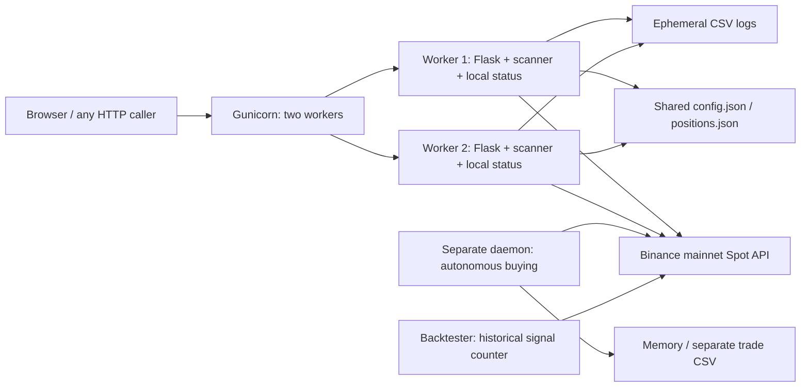

# End-to-end codebase and architecture audit

Date: 2026-10-02 (Africa/Lagos). Audited revision: `a71999a136b2532e4c84ce53564a98efcf9a77fb`.

## Executive assessment

The repository is a small trading prototype, not a verified production trading system. **Do not activate live execution in its current form.** The most serious issue is an unauthenticated public control plane that can disable paper mode and submit market orders using server credentials. Live exchange effects have no durable local lifecycle or reconciliation. Deployment introduces independent workers sharing non-atomic JSON files. Historical signal counts cannot establish strategy performance because the backtester leaks future information and does not simulate exits or capital.

This is an audit and discovery artifact, not an approved implementation specification. No production code, deployment, configuration, or exchange account was changed. Recommendations require direction selection before spec/tickets/implementation under the supplied workflow.

## Scope, method, and evidence boundaries

Reviewed every tracked functional module: `dashboard.py`, `topdown_daemon.py`, `backtester.py`, `utils.py`; README, dependency manifest, example environment, Render blueprint, ignore rules, and GitHub workflow. The initial working tree was clean. No repository-local AGENTS.md was found. Applied the user-supplied global instructions and the research/system-design-architect skills.

Verified selected paths through Flask's test client and fake exchange calls. `offline_probes.py` parses the dashboard and removes its final startup branch before evaluation, so it does not start the bot, read a real .env, or contact Binance. Persistence and CSV writes go to a temporary directory. This deliberately avoids exercising normal import startup and therefore does not prove process deployment behavior. Source compilation checks syntax only. No production, sandbox, device, browser, network latency, performance benchmark, credential, or account verification was performed. No test suite or lockfile exists in the supplied repository; hosted CI status was not inspected.

Provider claims and current documentation are recorded in [provider research](provider-research-2026-10-02.md). Source anchors below refer to the audited revision. Findings marked reproduced refer to the attached offline probe; other findings are source-derived.

## Actors, intended journeys, and actual behavior

Assumption: one operator manages one Binance Spot account. There is no evidence of tenants, customer custody, or a marketplace; do not add these concepts without requirements.

1. **Dashboard operator:** opens `/`, observes volume-selected markets and 4h/1h/15m signals, sizes a manual order, submits `/trade`, then observes positions and optionally closes `/close`. Paper orders update local records; live orders only call Binance and flash/log the returned object. Consequently the live journey cannot reach a trustworthy local position/exit/performance view.
2. **Automated daemon operator:** launches a separate script, scans 1d/4h/15m signals, calculates allocation, buys, then submits TP and SL. It has no persistent position recovery, fill reconciliation, exit tracking, or decrement of its position counter.
3. **Researcher:** runs a hard-coded SOL date range and gets entry counts. There is no portfolio simulation, return series, fees, slippage, exits, exposure accounting, or risk-adjusted result.
4. **Deployer:** starts two Gunicorn workers via Render. Each imports the dashboard and starts its own background scanner; separate memory and shared JSON can diverge. Blueprint requests a free service with a disk, which current Render documentation does not support.

## Reconstructed architecture



There is no authentication boundary between callers and credentialed exchange writes. Binance is authoritative for actual balances, orders, and fills. Dashboard memory is authoritative only for its simulation; JSON files are mutable snapshots, not an order journal. No component connects those domains after a live fill.

Strengths: small comprehensible modules; CCXT rate limiting enabled; shared indicator helpers; paper default; bounded dashboard recent-trade/equity lists; market-data retry attempts; template escaping and JSON serialization used in most rendering paths; example credentials are placeholders; .env and runtime files are ignored. These are useful starting points, not sufficient financial safety controls.

## Prioritized findings

Severity follows the architect skill: P0 irreversible financial/security exposure, P1 major correctness or expected outage, P2 operational/scaling weakness, P3 maintainability. Exposure likelihood depends on public deployment and trading-capable credentials; the audit does not establish either exists today.

| ID | Severity / confidence | Evidence and consequence | Smallest viable remediation |
|---|---|---|---|
| A01 | P0, reproduced with fake orders | `dashboard.py:474-561`: no auth, authorization, CSRF, or trading permission guard on trade/close/config/reset. Partial `/update-config` omitting `paper_trading` sets it false (539-544); any reachable caller can then invoke credentialed market orders. | Authenticate all control and account-read paths; protect browser mutations against CSRF; enforce an independent server-side live-execution allow gate. Treat mode change as an explicit operation. |
| A02 | P1, source + reproduced | `dashboard.py:480-485,505-510`: live fills are never written into positions, trade history, or account state. Exit signals iterate local positions only (455-464). Local positions survive mode changes with no account/mode identity. A paper-derived `/close` can submit a real sell. | Separate paper/live state namespaces; journal order intent and provider observations; reconcile real fills/balances; block mode changes with unresolved orders or positions. |
| A03 | P1, reproduced with fake orders | `dashboard.py:483,508`; daemon 173-182: no stable operation/client-order ID or ambiguous-outcome handling. Repeated HTTP submissions created two mocked orders. Buy success followed by protection/log failure is only reported as an order failure; counter/cooldown remain unchanged. | Durable intent before submission, business deduplication, provider order lookup before resubmission, explicit unknown/reconciliation-required state. Do not claim exactly-once network delivery. |
| A04 | P1, source + provider verified | `topdown_daemon.py:81,167` assumes `limits.amount.step`, absent from normal CCXT market limits; offline ordinary market shape raised KeyError. TP/SL at 96-98 uses separate full-quantity sells and Spot-incompatible STOP_MARKET. TP can reserve the quantity before SL submission fails. | Use CCXT precision helpers plus exchange filters; verify supported Spot contingent/OCO contracts and available quantity; confirm protection acceptance and reconcile partial failure. |
| A05 | P1, source | `topdown_daemon.py:119,126`: parsed TESTNET flag is ignored; mainnet is forced. README recommends testnet, `.env.example:50` says dashboard ignores it. Dashboard never loads dotenv; daemon does. | Explicit independent venue and execution-mode configuration, validated fail-closed startup, accurate instructions, testnet acceptance before any mainnet rollout. |
| A06 | P1, source | `render.yaml:19`, `dashboard.py:1022-1027`: two workers start two scanners, each with private config/positions. Shared files have no locks, transactions, or atomic rename (137-144,208-215). Concurrent requests also mutate shared lists within a worker. | Separate supervised scanner/executor ownership from HTTP workers; transactional shared store, consistent reads, and serialized account writes. A single worker is only temporary containment. |
| A07 | P1, reproduced | `dashboard.py:285-310`: negative quantities accepted; selling -2 against qty 1 produced qty 3. Unknown/stale symbols may fill at zero (287); every non-buy side is treated as sell. No balance reservation, fee model, max-position/cooldown/risk enforcement. | Validate finite positive qty, canonical side, active allowed market, fresh price, cash/holdings, limits, and configured exposure on server. Reject invalid input without mutation. |
| A08 | P1, source | `backtester.py:12-37`: latest 1000 daily bars instead of date-paginated history; same-day final daily close gates intraday entries; 1000 4h bars extend ~167 days and 1000 15m bars ~10.4 days without an end/as-of restriction. A future 4h event can authorize an earlier entry; subsequent daily iterations overlap. | Event-time replay using only completed bars available at each decision; paginate requested range and warmup; timestamp-align gates and entries; reject incomplete history. |
| A09 | P1, source | Backtest omits daemon EMA50 and RSI bias and dashboard's distinct timeframes/RSI-cross execution. Returns only entries. The strategies are three different contracts, so results cannot validate either runtime or profitability. | Select an authoritative strategy, extract one deterministic evaluator, and build fill/exit/capital simulation with fees and slippage. Do not select a strategy silently during fixes. |
| A10 | P1, source | Daemon `open_positions` only increments (131,179) and never reconciles/decrements; cooldown disappears on restart. Uses quote total rather than account equity, ignores free balance (138-171), and records requested amount/price rather than confirmed filled quantity/average/fees (174-176). | Recover order/position state on startup; decrement from confirmed lifecycle events; cap allocation to available funds/exposure; use verified fills. |
| A11 | P1, source | Dashboard scanner has no encompassing supervisor (331-472); exceptions outside local try blocks terminate daemon thread. `bot_status` remains literal Running (108), last_scan is written before completion (342), exits only suggest manual closes, trailing_pct is unused. | Supervision and heartbeat; successful-scan timestamp and degraded/stale states; define manual versus automatic protection explicitly; never advertise unused exit protection. |
| A12 | P1, provider verified | `render.yaml:6,20-23`: free tier cannot attach persistent disk; free web lifecycle also does not suit continuous risk protection. README describes Free/Starter as options with persistent data. | Select supported paid persistent deployment with documented recovery; validate blueprint and lifecycle before activation. |
| A13 | P2, reproduced + source | Config type casts do not validate ranges/finite values; equity_proxy is absent from type map (148-164) despite rendered input. DATA_DIR is not created, writes truncate in place, save failures allow continued mutation/successful simulated trades, malformed snapshots fall back to empty state. | Versioned validated config; transactional persistence; halt execution on state-write failure/corruption; restore procedure and backup checks. |
| A14 | P2, source | Profit/win-rate are derived from only newest 20 trades (314,396-410), lost on restart. Drawdown divides profit decline by peak profit rather than account equity (412-420), giving misleading values or zero after initial loss. | Durable fill history, capital-aware equity and drawdown, explicit realized/unrealized values and fees; relabel incomplete estimates meanwhile. |
| A15 | P2, source | Mutable settings change during scans/orders with no snapshot/version. Changing quote/universe can orphan prices for held positions; on ticker failure exits may use old cache (223-230). Current unfinished candles feed decisions throughout modules. | Immutable config per scan/order, freshness metadata and held-symbol market coverage; closed-candle contract and stable candle/signal IDs. |
| A16 | P2, source | Default public session secret (76); direct debug launch binds all interfaces (1021) and reloader can duplicate scanner. Errors and full provider order objects enter UI/logs (484-488). `/api/status` is public with wildcard CORS. | Required production secret; debug only isolated development; redact logs; authenticated restricted account telemetry. Verify actual network exposure separately. |
| A17 | P2, source | CI only lints/imports, no behavior tests; dashboard import starts outbound scanner. Known unused imports imply pyflakes failures in existing source. Render autoDeploy is enabled separately from post-CI hooks, so configuration may allow ungated/double deployment. Dependencies have open lower bounds. | Side-effect-free app creation; pinned reproducible dependencies; meaningful offline/sandbox suites; one CI-gated deployment owner with health and rollback checks. Hosted status/config remains unverified. |
| A18 | P2, source UI review | 15-second full-page refresh interrupts form entry (571), no mode banner/review step, unknown/stale status conflated with no signals, stale Running badge, internal config labels, and no persistent order status. Toasts lack live-region semantics (589,958-969). | Preserve forms; explicit venue/mode/data age; order review and durable outcome; distinguish unavailable/empty; accessible announcements and errors. Browser contrast/focus/reflow requires separate validation. |
| A19 | P3, source | Strategy duplication, inline 450-line template, unused helpers/config fields, lower-bound dependencies, minimal README, no operational runbook. RSI uses rolling means (utils 7-12), not Wilder smoothing; close-based pivots (14-24) differ from OHLC swing highs/lows. | Document exact indicator definitions before altering them; share evaluators and split presentation after behavioral baselines. No gratuitous rewrite. |

## Offline evidence

Run from repository root: `python docs/audits/offline_probes.py`. Observed on Python 3.11.3:

```json
{
  "anonymous_status_http": 200,
  "anonymous_dashboard_http": 200,
  "anonymous_partial_config_disables_paper": true,
  "negative_risk_accepted": true,
  "negative_buy_position_qty": -1.0,
  "negative_sell_increases_holdings_to": 3.0,
  "missing_price_entry": 0.0,
  "equity_proxy_discarded": true,
  "duplicate_live_requests_mock_order_count": 2,
  "live_fill_leaves_positions_unchanged": true,
  "missing_data_dir_save_returns_false": true,
  "standard_market_shape_buy_keyerror": "'step'",
  "source_syntax_compile": "all four modules passed"
}
```

These are observed defects, not passing acceptance tests. Normal exchange schema behavior is additionally corroborated by provider research. The harness is an audit attachment; it does not constitute a production regression suite.

## Data ownership, contracts, and critical lifecycle gaps

Current persisted position schema is `{symbol, entry, qty, pnl}`; it lacks account, venue, mode, order IDs, fill IDs, timestamps, strategy/config version, status, fee currency, and provenance. Current config is mutable JSON; cooldowns, trade history, and equity history are not recovered. CSV is an auxiliary log outside DATA_DIR and records simulation mode even though live routes do not log through this broker. Cross-currency values are not qualified reliably when base_quote changes.

Current HTTP contracts: GET `/` HTML; GET `/api/status` JSON; POST `/trade` symbol/side/qty; POST `/close` symbol/qty; POST `/update-config` partial configuration; POST `/reset-config`. POST endpoints redirect and flash on both failures and successes, with no operation ID or durable status resource. Paper rejection still receives a success flash. There are no internal business-event contracts or queues.

Minimum desired lifecycle, subject to approval: durable order intent -> submitting -> accepted/partially_filled/filled/rejected/canceled, with an explicit unknown outcome requiring reconciliation. Protection must have its own lifecycle. Never mark a position protected until the exchange confirms the protective order. Persist actual fills and fees, and derive holdings from reconciled fills rather than submitted quantity. Startup must reconcile unresolved intents before new execution. Decimal exchange-native quantity/price strings and currency-qualified values should replace binary float arithmetic for accounting and filter checks; crypto quantity precision cannot be reduced to a universal two-decimal minor unit.

## Reliability and failure-mode review

| Failure | Current behavior | Required boundary |
|---|---|---|
| Exchange accepts order but response times out | Error, no durable unknown state; caller can resubmit | Lookup stable reference; reconcile before retry |
| Buy fills, stop submission fails | Daemon logs order failed; holdings may remain exposed | Persist buy and failed protection independently; halt/recover |
| Worker restart or request hits other worker | New/stale local status, recent history lost | Shared durable ownership and startup reconciliation |
| JSON corruption or disk full | Empty fallback or non-durable mutation | Fail closed for execution; verified restore |
| Binance rate limit / outage | Short broad retries, stale/absent data | Error-class handling, backoff/jitter, freshness gates |
| Scanner thread dies | Web remains up, Running badge remains | Supervision, heartbeat and actionable alert |
| Config/mode changes mid-operation | Mixed rules/account domains | Versioned operation snapshot; guarded transition |
| Operator misses manual exit | No dashboard automatic protection | Explicit responsibility and verified exchange protection policy |

There is no established backup retention, tested restore, RPO/RTO, graceful worker shutdown, trade kill switch, reconciliation schedule, or incident runbook. Define these before live rollout. A web HTTP 200 cannot establish scanner health or order protection.

## Capacity, caching, scalability, and cost

No observed traffic/load/SLOs are available. Derived scan estimate: each dashboard worker uses two ticker calls, `3N` signal OHLCV calls and approximately `3P` held-position exit calls per cycle, with 10 seconds sleep **after** the serial work. At N=12/P=5 this is roughly 53 calls/cycle; two workers roughly 106. If work took zero time, the upper-bound cadence is 636 calls/minute. Real latency, rate limiter waits and retries lower cadence and increase signal age. Binance request weight differs by endpoint; call counts are not request-weight compliance proof.

Browser polling at 15 seconds gives approximately `4U` page requests/minute for U continuously viewing users, duplicating HTML and resetting forms. Cost drivers are a reliable always-on service, durable storage/backups, market-data requests, and observability. No measured budget supports Redis, Kafka, microservices, sharding, or multi-region deployment.

Start with one supervised account executor/scanner and authenticated web app using transactional state. SQLite can fit a single-host, low-volume operator deployment with an explicitly tested concurrency/backup plan; shared Postgres fits independently deployed workers. Choose after defining topology and availability requirements. Cache market data by venue/symbol/timeframe/closed-bar timestamp with fetched-at metadata; invalidate on new bars, refuse stale execution inputs, and never treat cached prices as authoritative fills. Growth triggers: scan completion misses candle timing, exchange-weight headroom shrinks, request latency exceeds target, or account count requires isolated executors. Optimize candle reuse and centralized rate budgets before adding infrastructure.

Suggested acceptance targets, **not established requirements**: all financial mutations authenticated and journaled; no orders from invalid/stale inputs; unresolved provider outcomes block conflicting execution; a dead scanner becomes visible within two configured scan intervals; restored holdings reconcile before execution. Numerical latency, freshness, capital/exposure, backup RPO/RTO and recovery targets need operator decisions.

## UI, accessibility, privacy, and trust

Retain familiar symbol/side controls and existing layout as a baseline. Add separate visible simulation/mainnet/testnet mode, successful scan age, available funds, projected exposure, fee estimate, pending/unknown/protected order states, and actionable reconciliation errors. Disable submission when price/account state is unavailable. Preserve typed quantities during refresh and errors. Keep independent positions closable through a deliberate reviewed action rather than only when an exit signal exists. Use stable candle-based signal identity instead of new scan timestamps to avoid repeated alerts.

Source has responsive grids, wrapped labels, and scrollable tables, but there is no verified WCAG 2.2 AA acceptance. Verify keyboard/focus, screen-reader announcements, tiny close buttons, contrast, zoom/reflow and error placement in a browser. Do not create a new design system just for this audit. Tailwind's runtime CDN adds a production third-party dependency; bundle assets when formalizing deployment. Account positions/config should not be exposed through unauthenticated CORS-enabled telemetry. Do not include secrets or provider payloads in durable research artifacts.

## Recommended dependency order and approval boundary

1. **Contain execution exposure:** authenticated control plane, explicit live gate, mode/venue clarity, validation and safe production startup. Confirm public reachability and key permissions separately; no key/deployment changes were made here.
2. **Resolve product decisions:** authoritative strategy/timeframes; dashboard advisory/manual versus automated execution; account and mode separation; capital/exposure/protection policy.
3. **Build durable correctness foundation:** transactional intents/fills/config, one execution owner, reconciliation and restart recovery, exchange precision and contingent-order acceptance.
4. **Validate strategy and simulation:** shared deterministic evaluator, closed-candle timing, event-time historical replay, cash/fees/slippage and performance accounting.
5. **Operationalize:** compatible deployment, dependency pinning, CI behavioral/security tests, supervision/alerts, backups/restore, runbooks, then controlled sandbox acceptance.
6. **Roll out only when authorized:** preserve paper data, migrate/version state, reconcile before cutover, stage activation, prove real journeys and record deployed revision. Rollback disables new writes and preserves/reconciles orders already on the exchange; rolling back code cannot reverse fills.

After direction approval, use to-spec and to-tickets; maintain A01-A19 -> spec -> ticket -> acceptance evidence coverage. No tickets were published or implemented by this audit. Preserve Flask/CCXT and simple deployment until measured needs justify replacement. Do not invent multi-tenant wallets, ledgers for customer obligations, or hyperscale infrastructure; this project has no demonstrated requirement for them.

## Open decisions and remaining verification

- Is this an advisory paper dashboard, a manual live terminal, an automated strategy, or all three with explicit boundaries?
- Which strategy is authoritative: 1d/4h/15m daemon or 4h/1h/15m dashboard? Which indicator definitions and completed-bar timing are intended?
- What accounts/venues, initial capital, maximum exposure, daily-loss limit, and protection policy are approved?
- What deployment currently exists, who can reach it, and do any credentials have trading permission? Source alone cannot answer.
- What backup/recovery and supervision ownership is acceptable? What happens during operator absence?
- Required follow-up evidence: full offline suite, historical causal replay, provider testnet order/filter/partial-failure tests, process deployment and restore tests, browser accessibility/usability acceptance, and separately authorized controlled live acceptance. None is closed by this report.
