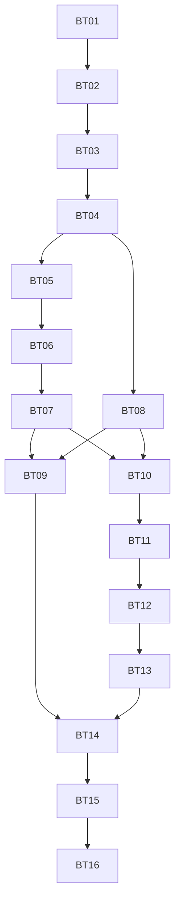

# Audit-remediation execution ledger

Date: 2026-10-02. Source revision: a71999a136b2532e4c84ce53564a98efcf9a77fb.

## Current stage

Research/discovery complete within recorded static/offline/provider evidence boundaries. The user approved both test boundaries and the complete 16-ticket granularity/dependency breakdown on 2026-10-02. Tracker selection/publication is now resolved to repository GitHub Issues. Specification #2 and 16 tickets are published and verified with 18 native dependency edges. D05 and D07 remain unresolved; BT01 is implemented and closed; no deployment or trading has been performed.

Approval evidence: the user replied "approve" to the explicit request to approve the two test boundaries and ticket granularity/dependency breakdown. It supplies that approval once; do not ask for it again. The subsequent user instruction "go on" authorized continuation; the agent announced and used the existing repository GitHub Issues destination. It also does not supply D05 and D07 policy selections or rollout authorization.

Authoritative source inputs: existing end-to-end audit A01-A19 and provider research PR01-PR07. Current proposed spec: [implementation-spec.md](implementation-spec.md). Do not create another competing spec on resume; revise this one with decision/evidence history.

## Configured tracker and verified publication

Tracker: GitHub Issues for adeoyewole028/binance_topdown_full; label ready-for-agent. [Published specification #2](https://github.com/adeoyewole028/binance_topdown_full/issues/2). [Tracker configuration](tracker-config.md) records the continuation authorization and destination. [Publication manifest](publication.json) records all issue IDs, URLs and dependencies. GitHub issues are ticket status truth; local files remain mirrors/evidence.

All 16 approved slices were published in dependency order, read back and verified as open with complete bodies and explicit decision blockers. Native blocking links and body references match the 18 approved edges. No parent issue was closed or edited because the children were created. This label is triage, not permission to start blocked work. D05 and D07 and external provider/rollout gates remain explicit.

## Approved ordered ticket breakdown

| Draft ID | Title and complete draft | Genuine prerequisite tickets | Decision conditions | Status |
|---|---|---|---|---|
| [BT01 #3](https://github.com/adeoyewole028/binance_topdown_full/issues/3) | [Establish safe regression and acceptance baselines](ticket-drafts/01-offline-regression-baseline.md) | None | None additional | Complete / closed |
| [BT02 #4](https://github.com/adeoyewole028/binance_topdown_full/issues/4) | [Secure control access and explicit environment transitions](ticket-drafts/02-secure-control-and-environment.md) | [BT01 #3](https://github.com/adeoyewole028/binance_topdown_full/issues/3) | D01 approved | Complete / closed |
| [BT03 #5](https://github.com/adeoyewole028/binance_topdown_full/issues/5) | [Recover isolated state under one execution owner](ticket-drafts/03-durable-runtime-and-migration.md) | [BT02 #4](https://github.com/adeoyewole028/binance_topdown_full/issues/4) | D02/D06 approved | Published / open |
| [BT04 #6](https://github.com/adeoyewole028/binance_topdown_full/issues/6) | [Expose fresh market data and supervised scan health](ticket-drafts/04-fresh-supervised-market-data.md) | [BT03 #5](https://github.com/adeoyewole028/binance_topdown_full/issues/5) | D07 | Published / open |
| [BT05 #7](https://github.com/adeoyewole028/binance_topdown_full/issues/7) | [Execute credible paper orders within capital and risk limits](ticket-drafts/05-validated-paper-and-risk.md) | [BT04 #6](https://github.com/adeoyewole028/binance_topdown_full/issues/6) | D05 | Published / open |
| [BT06 #8](https://github.com/adeoyewole028/binance_topdown_full/issues/8) | [Dispatch exchange orders with durable fill reconciliation](ticket-drafts/06-live-intents-and-reconciliation.md) | [BT05 #7](https://github.com/adeoyewole028/binance_topdown_full/issues/7) | D05 | Published / open |
| [BT07 #9](https://github.com/adeoyewole028/binance_topdown_full/issues/9) | [Protect confirmed positions and close without overselling](ticket-drafts/07-protection-and-safe-close.md) | [BT06 #8](https://github.com/adeoyewole028/binance_topdown_full/issues/8) | D05 | Published / open |
| [BT08 #10](https://github.com/adeoyewole028/binance_topdown_full/issues/10) | [Evaluate selected strategy profiles from completed candles](ticket-drafts/08-versioned-causal-strategies.md) | [BT04 #6](https://github.com/adeoyewole028/binance_topdown_full/issues/6) | D04 approved | Published / open |
| [BT09 #11](https://github.com/adeoyewole028/binance_topdown_full/issues/11) | [Run automation through the same reconciled order lifecycle](ticket-drafts/09-daemon-through-shared-executor.md) | BT07, BT08 | D03 approved | Published / open |
| [BT10 #12](https://github.com/adeoyewole028/binance_topdown_full/issues/12) | [Backtest complete historical ranges with causal execution](ticket-drafts/10-historical-causal-replay.md) | BT07, BT08 | D05 | Published / open |
| [BT11 #13](https://github.com/adeoyewole028/binance_topdown_full/issues/13) | [Report performance from full history and account equity](ticket-drafts/11-durable-account-performance.md) | [BT10 #12](https://github.com/adeoyewole028/binance_topdown_full/issues/12) | D05 | Published / open |
| [BT12 #14](https://github.com/adeoyewole028/binance_topdown_full/issues/14) | [Keep operator status and settings truthful and accessible](ticket-drafts/12-operator-status-and-settings.md) | [BT11 #13](https://github.com/adeoyewole028/binance_topdown_full/issues/13) | D01 approved | Published / open |
| [BT13 #15](https://github.com/adeoyewole028/binance_topdown_full/issues/15) | [Review orders and recover pending or unprotected positions](ticket-drafts/13-reviewable-order-recovery-ui.md) | [BT12 #14](https://github.com/adeoyewole028/binance_topdown_full/issues/14) | None additional | Published / open |
| [BT14 #16](https://github.com/adeoyewole028/binance_topdown_full/issues/16) | [Package a supported deployment with recovery and CI gates](ticket-drafts/14-operations-ci-and-release.md) | BT09, BT13 | D07 | Published / open |
| [BT15 #17](https://github.com/adeoyewole028/binance_topdown_full/issues/17) | [Prove integrated paper and Spot testnet acceptance](ticket-drafts/15-integrated-paper-and-sandbox-acceptance.md) | [BT14 #16](https://github.com/adeoyewole028/binance_topdown_full/issues/16) | D07 | Published / open |
| [BT16 #18](https://github.com/adeoyewole028/binance_topdown_full/issues/18) | [Run authorized canary and close with production evidence](ticket-drafts/16-authorized-rollout-and-closure.md) | [BT15 #17](https://github.com/adeoyewole028/binance_topdown_full/issues/17) | D07 | Published / open |

## Dependency graph

Recommended strict sequential order is BT01 through BT16. Only the currently selected ticket may be implemented; dependency independence is not authorization for parallel execution. Technical branch points exist after BT04 (BT05 and BT08) and after BT07/BT08 (BT09 and the replay/accounting branch), but parallel work is not enabled by default. No ticket is execution-ready until its material decisions are resolved and implementation is authorized; seam/breakdown reviews are already approved. BT15 additionally needs isolated deployment/testnet access authorization; BT16 additionally needs explicit rollout/mainnet budget and monitoring approval.

## Approved acceptance seams

1. Operator HTTP request -> durable state -> owned executor -> fake exchange observation -> HTTP status/holdings. One high-level seam covers auth, config/mode, paper/live lifecycle, duplicate/unknown outcomes and recovery. Multi-process and browser acceptance validate behavior above this seam.
2. Versioned strategy evaluator -> chronological replay -> deterministic fills/accounting, using timestamped completed-bar fixtures and clock. This distinct computational seam proves causality and parity without relying on HTTP helper structure.

Provider acceptance remains a real Spot testnet journey; actual rollout remains separately authorized. These are external proof layers, not an excuse to proliferate helper-level test seams.

## Planning completeness and breakdown review

- All audit A01-A19 and provider PR01-PR07 findings map to requirements and ticket evidence in [traceability](traceability.md).
- Every R01-R20 has at least one implementation and explicit acceptance owner; validation BT15 covers the integrated matrix.
- Each draft contains objective/context, scope/components, prerequisite/decision blockers, implementation requirements, observable criteria, tests/checks, regressions/security, migration/rollout, evidence, exclusions and handoff status.
- Slices are meaningful operator/research journeys. BT01 is a justified regression baseline; BT03 is a necessary ownership/migration foundation; BT14-BT16 are explicit operational and independent verification/rollout gates. No future-ticket implementation is hidden in these prerequisites.
- Redundant dependencies were removed: BT11 depends on BT10, which transitively covers exchange fills and paper protection; BT12 depends on BT11, BT13 on BT12, and BT14 directly on BT09 and BT13. The remaining direct blockers genuinely gate each slice.
- Protection follows fill reconciliation; automated daemon and historical replay follow both the shared protection/simulation rules and selected causal evaluator. Metrics follow exchange fills plus approved replay accounting. UI/status follows the metrics/reconciled contracts. Release follows all runtime/UI branches. No cycles.
- Existing Flask/CCXT, indicator definitions, valid universe/risk/manual workflows and optional sound are protected; unsafe/false states are intentionally corrected. No forced visual or infrastructure rewrite.
- Seam/breakdown review and publication are verified. Remaining gaps are decision readiness, not unmapped audit findings: D05 and D07 require recorded selection/approval; D05 includes exact capital/cost-basis/intrabar/protection limits, D07 includes numeric SLO/backup/canary targets. Those values must enter spec/criteria before affected work starts. D08 is resolved.

## Session handoff

Current ticket: BT01 complete and issue #3 closure verified; BT02 is current. BT01: 39 cases (29 pass, 10 known-defect strict xfails), type/lint/source compile checks pass, Standards/Spec review 0 findings, implementation commit 8fed3dca4d6f42386541ee0af4b20f72e702968b. Application source is unchanged by the baseline. Published specification: #2. Published tickets: #3-#18 (BT01-BT16). Planning commit: 4d7506d7da06b5f76e33f0d2a1a6caaa25770884. Baseline implementation commit: 8fed3dca4d6f42386541ee0af4b20f72e702968b. Seam/breakdown approval: recorded. Publication and tracker gates: satisfied. Remaining blockers: D05 and D07 consequential policy choices; later provider/deployment/mainnet access and authorization.

Next permitted step: resolve material policy decisions for affected tickets and, only on a separate implementation instruction, start BT01 then proceed strictly in dependency order. Publication is complete; do not recreate the spec or issues. Do not repeat the seam/granularity review. The user subsequently authorized strict implementation; feature work now follows the ticket gates. When implementation is subsequently requested, read this ledger, verify blockers and work exactly one approved ticket at a time with full gates/review/commit before advancing.

## Approved decision update

D01: the user selected a single configured operator with a password, secure session and CSRF on 2026-10-02. The specification and affected GitHub tickets #4/#14 record it. Remaining material decisions are D05 and D07.

## BT01 completion evidence

All four criteria are satisfied; see [validation](evidence/bt01-validation.md) and [machine-readable baseline](evidence/bt01-baseline.json). Known defect xfails are explicitly later-ticket work, not successful safety acceptance. Full suite independently rerun by Spec review; relevant checks passed. Do not revisit BT01 unless a demonstrated integration/regression issue arises.

## Continuation on 2026-10-02

BT01 #3 closed and read-back verified after all acceptance gates. BT02 #4 is the sole current ticket; fixed point will be the bookkeeping commit preceding its implementation. User selected D02 single-host SQLite/single owner, D03 explicit disabled automation, D04 both named/versioned profiles. Specification #2, affected issues and publication manifest updated. D05 and D07 remain unresolved. No push or deployment performed.

D06 approved on 2026-10-03: keep all legacy snapshots quarantined/read-only until each paper origin is confirmed; exchange balances/holdings require reconciliation. Spec #2 and BT03 #5 updated. BT02 is still the sole active implementation ticket.

BT02 validation on 2026-10-03: full offline suite 76 cases, 69 pass/7 strict later-ticket expected failures; 13-source strict type check and repository lint pass. BT02 acceptance implemented; independent Standards/Spec reviews and closure are pending. All changes stay within access/environment/launch scope. D06 selection was recorded as authorized change control, with no BT03 code started.

## BT02 closure and current permitted step

BT02 #4 CLOSED, verified after all five criteria/checks/reviews. Commits 31173c7 and 1a5b740; 73 pass/7 strict future defects, type14 and repository lint/9-source compilation pass. Standards0 and Spec0 remaining actionable findings after corrections. Next sole permitted implementation ticket: BT03 #5, once its now-closed prerequisite is read-back verified. D02 single-host SQLite/single owner and D06 quarantine are approved. D07 target proposal is pending user input; D05 values remain unresolved. No source push, deployment or actual trading.

## BT03 work in progress (2026-10-03)

Current sole ticket BT03 #5, OPEN. Fixed point dd950b8f01565eba61b5e79e9b5beb0d2484b338; BT02 closure verified, D02/D06 approved. First TDD tracer reproduced inconsistent configuration in two HTTP workers, then passed using namespace-qualified SQLite/config versions. Explicit provisioning and independent state identity; opening never recreates missing required state. Config mutations serialize and append immutable versions. Failed-commit rollback and missing-database HTTP tests pass. Focused current check: 20 passed; mypy15 and focused lint pass. Only configuration foundation is implemented so far. Ownership, intent/fill journals, intake/worker, quarantine/import, backup/restore, JSON cutover and all six acceptance gates remain incomplete.

Uncommitted source: state_store.py, tests/test_durable_runtime.py, dashboard.py configuration integration, tests/legacy_sandbox.py disposable provisioning and one security regression adapted to the authoritative namespace. Process-local mode mutation is ignored; no exchange effects. Logout remains independent of unavailable financial state. Next permitted step: extend BT03 transactional schema and owned intake/worker; migrate positions under approved quarantine; prove concurrency, recovery and rollback; full checks/two-axis review/commit before closure. Do not start BT04. D07 proposal pending; D05 values unapproved. No push, provider calls, active-service changes or deployment.

## BT03 pre-review state (supersedes the earlier partial handoff)

Owned durable intake/projection/journal, configuration versions, namespace isolation, shared scan snapshots, explicit maintenance CLI, read-only quarantine/attestation and online backup/isolated restore are now implemented. Disposable recovery checks include a real killed subprocess owner, second-owner refusal, pending-intent restart, full-disk commit rollback, unresolved dispatch block, missing/corrupt store, repeat/anomalous import and refusal to discard newer journal effects. Legacy JSON writers and independent daemon execution are retired; automation integration stays BT09. New schema identities include later protection/reservations/observations/cooldown lifecycles without activating their behavior. Three BT05 baseline defects became required BT03 projection invariants and ordinary regressions (negative buy/sell and missing price); no D05 simulator/risk policy was selected or claimed complete.

Pre-review: full suite 93 pass/4 strict future xfails, 97 cases; mypy22, repository lint, 15-source compile pass. Review fixed point remains dd950b8f01565eba61b5e79e9b5beb0d2484b338. All BT03 criteria remain open until two-axis review/corrections, evidence and scoped commits. Next permitted step is BT03 review only; BT04 has not started. No actual legacy files, live services, provider state, source publication or deployment changed. D05/D07 remain unanswered.
