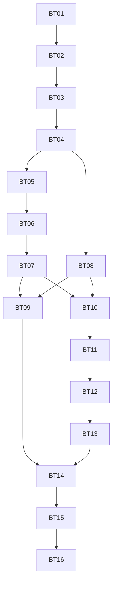

# Audit-remediation execution ledger

Date: 2026-10-02. Source revision: a71999a136b2532e4c84ce53564a98efcf9a77fb.

## Current stage

Research/discovery, approved specification and all 16 dependency-ordered GitHub tickets exist. D01-D07 choices, including both D05 rules and explicit operator setup, are approved and recorded. BT01-BT09 are CLOSED with local acceptance/review/commit evidence and verified tracker read-back. BT09 #11 closed/read-back verified2026-10-03T16:21:25Z; BT10 #12 is the sole active ticket after verified live inspection; no later ticket has started. Actual provider acceptance, deployment and trading remain separate future gates. No real provider/funding/trade/migration/deployment/push has occurred.

Approval evidence: the user replied "approve" to the explicit request to approve the two test boundaries and ticket granularity/dependency breakdown. It supplies that approval once; do not ask for it again. The subsequent user instruction "go on" authorized continuation; the agent announced and used the existing repository GitHub Issues destination. It also does not supply D05 and D07 policy selections or rollout authorization.

Authoritative source inputs: existing end-to-end audit A01-A19 and provider research PR01-PR07. Authoritative approved spec: [implementation-spec.md](implementation-spec.md). Do not create another competing spec on resume; revise this one with decision/evidence history.

## Configured tracker and verified publication

Tracker: GitHub Issues for adeoyewole028/binance_topdown_full; label ready-for-agent. [Published specification #2](https://github.com/adeoyewole028/binance_topdown_full/issues/2). [Tracker configuration](tracker-config.md) records the continuation authorization and destination. [Publication manifest](publication.json) records all issue IDs, URLs and dependencies. GitHub issues are ticket status truth; local files remain mirrors/evidence.

All 16 approved slices were published in dependency order, read back and verified as open with complete bodies and explicit decision blockers. Native blocking links and body references match the 18 approved edges. No parent issue was closed or edited because the children were created. This label is triage, not permission to start blocked work. D05 and D07 and external provider/rollout gates remain explicit.

## Approved ordered ticket breakdown

| Draft ID | Title and complete draft | Genuine prerequisite tickets | Decision conditions | Status |
|---|---|---|---|---|
| [BT01 #3](https://github.com/adeoyewole028/binance_topdown_full/issues/3) | [Establish safe regression and acceptance baselines](ticket-drafts/01-offline-regression-baseline.md) | None | None additional | Complete / closed |
| [BT02 #4](https://github.com/adeoyewole028/binance_topdown_full/issues/4) | [Secure control access and explicit environment transitions](ticket-drafts/02-secure-control-and-environment.md) | [BT01 #3](https://github.com/adeoyewole028/binance_topdown_full/issues/3) | D01 approved | Complete / closed |
| [BT03 #5](https://github.com/adeoyewole028/binance_topdown_full/issues/5) | [Recover isolated state under one execution owner](ticket-drafts/03-durable-runtime-and-migration.md) | [BT02 #4](https://github.com/adeoyewole028/binance_topdown_full/issues/4) | D02/D06 approved | Complete / closed verified |
| [BT04 #6](https://github.com/adeoyewole028/binance_topdown_full/issues/6) | [Expose fresh market data and supervised scan health](ticket-drafts/04-fresh-supervised-market-data.md) | [BT03 #5](https://github.com/adeoyewole028/binance_topdown_full/issues/5) | D07 approved | Complete / closed verified |
| [BT05 #7](https://github.com/adeoyewole028/binance_topdown_full/issues/7) | [Execute credible paper orders within capital and risk limits](ticket-drafts/05-validated-paper-and-risk.md) | [BT04 #6](https://github.com/adeoyewole028/binance_topdown_full/issues/6) | D05 approved | Complete / closed verified |
| [BT06 #8](https://github.com/adeoyewole028/binance_topdown_full/issues/8) | [Dispatch exchange orders with durable fill reconciliation](ticket-drafts/06-live-intents-and-reconciliation.md) | [BT05 #7](https://github.com/adeoyewole028/binance_topdown_full/issues/7) | D05 approved | Complete / closed verified |
| [BT07 #9](https://github.com/adeoyewole028/binance_topdown_full/issues/9) | [Protect confirmed positions and close without overselling](ticket-drafts/07-protection-and-safe-close.md) | [BT06 #8](https://github.com/adeoyewole028/binance_topdown_full/issues/8) | D05 approved | Complete / closed verified |
| [BT08 #10](https://github.com/adeoyewole028/binance_topdown_full/issues/10) | [Evaluate selected strategy profiles from completed candles](ticket-drafts/08-versioned-causal-strategies.md) | [BT04 #6](https://github.com/adeoyewole028/binance_topdown_full/issues/6) | D04 approved | Complete / closed verified |
| [BT09 #11](https://github.com/adeoyewole028/binance_topdown_full/issues/11) | [Run automation through the same reconciled order lifecycle](ticket-drafts/09-daemon-through-shared-executor.md) | BT07, BT08 | D03 approved | Complete / closed verified |
| [BT10 #12](https://github.com/adeoyewole028/binance_topdown_full/issues/12) | [Backtest complete historical ranges with causal execution](ticket-drafts/10-historical-causal-replay.md) | BT07, BT08 | D05 approved | Published / open |
| [BT11 #13](https://github.com/adeoyewole028/binance_topdown_full/issues/13) | [Report performance from full history and account equity](ticket-drafts/11-durable-account-performance.md) | [BT10 #12](https://github.com/adeoyewole028/binance_topdown_full/issues/12) | D05 approved | Published / open |
| [BT12 #14](https://github.com/adeoyewole028/binance_topdown_full/issues/14) | [Keep operator status and settings truthful and accessible](ticket-drafts/12-operator-status-and-settings.md) | [BT11 #13](https://github.com/adeoyewole028/binance_topdown_full/issues/13) | D01 approved | Published / open |
| [BT13 #15](https://github.com/adeoyewole028/binance_topdown_full/issues/15) | [Review orders and recover pending or unprotected positions](ticket-drafts/13-reviewable-order-recovery-ui.md) | [BT12 #14](https://github.com/adeoyewole028/binance_topdown_full/issues/14) | None additional | Published / open |
| [BT14 #16](https://github.com/adeoyewole028/binance_topdown_full/issues/16) | [Package a supported deployment with recovery and CI gates](ticket-drafts/14-operations-ci-and-release.md) | BT09, BT13 | D07 | Published / open |
| [BT15 #17](https://github.com/adeoyewole028/binance_topdown_full/issues/17) | [Prove integrated paper and Spot testnet acceptance](ticket-drafts/15-integrated-paper-and-sandbox-acceptance.md) | [BT14 #16](https://github.com/adeoyewole028/binance_topdown_full/issues/16) | D07 | Published / open |
| [BT16 #18](https://github.com/adeoyewole028/binance_topdown_full/issues/18) | [Run authorized canary and close with production evidence](ticket-drafts/16-authorized-rollout-and-closure.md) | [BT15 #17](https://github.com/adeoyewole028/binance_topdown_full/issues/17) | D07 | Published / open |

## Dependency graph

Recommended strict sequential order is BT01 through BT16. Only the currently selected ticket may be implemented; dependency independence is not authorization for parallel execution. Technical branch points exist after BT04 (BT05 and BT08) and after BT07/BT08 (BT09 and the replay/accounting branch), but parallel work is not enabled by default. No ticket is execution-ready until its material decisions are resolved and implementation is authorized; seam/breakdown reviews are already approved. BT15 additionally needs isolated deployment/testnet access authorization; BT16 additionally needs explicit rollout/mainnet budget and monitoring approval.

## Approved acceptance seams

1. Operator HTTP request -> durable state -> owned executor -> fake exchange observation -> HTTP status/holdings. One high-level seam covers auth, config/mode, paper/live lifecycle, duplicate/unknown outcomes and recovery. Multi-process and browser acceptance validate behavior above this seam.
2. Versioned strategy evaluator -> chronological replay -> deterministic fills/accounting, using timestamped completed-bar fixtures and clock. This distinct computational seam proves causality and parity without relying on HTTP helper structure.

Provider acceptance remains a real Spot testnet journey; actual rollout remains separately authorized. These are external proof layers, not an excuse to proliferate helper-level test seams.

## Planning completeness and breakdown review

- All audit A01-A19 and provider PR01-PR07 findings map to requirements and ticket evidence in [traceability](traceability.md).
- Every R01-R20 has at least one implementation and explicit acceptance owner; validation BT15 covers the integrated matrix.
- Each draft contains objective/context, scope/components, prerequisite/decision blockers, implementation requirements, observable criteria, tests/checks, regressions/security, migration/rollout, evidence, exclusions and handoff status.
- Slices are meaningful operator/research journeys. BT01 is a justified regression baseline; BT03 is a necessary ownership/migration foundation; BT14-BT16 are explicit operational and independent verification/rollout gates. No future-ticket implementation is hidden in these prerequisites.
- Redundant dependencies were removed: BT11 depends on BT10, which transitively covers exchange fills and paper protection; BT12 depends on BT11, BT13 on BT12, and BT14 directly on BT09 and BT13. The remaining direct blockers genuinely gate each slice.
- Protection follows fill reconciliation; automated daemon and historical replay follow both the shared protection/simulation rules and selected causal evaluator. Metrics follow exchange fills plus approved replay accounting. UI/status follows the metrics/reconciled contracts. Release follows all runtime/UI branches. No cycles.
- Existing Flask/CCXT, indicator definitions, valid universe/risk/manual workflows and optional sound are protected; unsafe/false states are intentionally corrected. No forced visual or infrastructure rewrite.
- Seam/breakdown review and publication are verified. Remaining gaps are decision readiness, not unmapped audit findings: D05 and D07 require recorded selection/approval; D05 includes exact capital/cost-basis/intrabar/protection limits, D07 includes numeric SLO/backup/canary targets. Those values must enter spec/criteria before affected work starts. D08 is resolved.

## Session handoff

Current ticket: BT01 complete and issue #3 closure verified; BT02 is current. BT01: 39 cases (29 pass, 10 known-defect strict xfails), type/lint/source compile checks pass, Standards/Spec review 0 findings, implementation commit 8fed3dca4d6f42386541ee0af4b20f72e702968b. Application source is unchanged by the baseline. Published specification: #2. Published tickets: #3-#18 (BT01-BT16). Planning commit: 4d7506d7da06b5f76e33f0d2a1a6caaa25770884. Baseline implementation commit: 8fed3dca4d6f42386541ee0af4b20f72e702968b. Seam/breakdown approval: recorded. Publication and tracker gates: satisfied. Remaining blockers: D05 and D07 consequential policy choices; later provider/deployment/mainnet access and authorization.

Next permitted step: resolve material policy decisions for affected tickets and, only on a separate implementation instruction, start BT01 then proceed strictly in dependency order. Publication is complete; do not recreate the spec or issues. Do not repeat the seam/granularity review. The user subsequently authorized strict implementation; feature work now follows the ticket gates. When implementation is subsequently requested, read this ledger, verify blockers and work exactly one approved ticket at a time with full gates/review/commit before advancing.

## Approved decision update

D01: the user selected a single configured operator with a password, secure session and CSRF on 2026-10-02. The specification and affected GitHub tickets #4/#14 record it. Remaining material decisions are D05 and D07.

## BT01 completion evidence

All four criteria are satisfied; see [validation](evidence/bt01-validation.md) and [machine-readable baseline](evidence/bt01-baseline.json). Known defect xfails are explicitly later-ticket work, not successful safety acceptance. Full suite independently rerun by Spec review; relevant checks passed. Do not revisit BT01 unless a demonstrated integration/regression issue arises.

## Continuation on 2026-10-02

BT01 #3 closed and read-back verified after all acceptance gates. BT02 #4 is the sole current ticket; fixed point will be the bookkeeping commit preceding its implementation. User selected D02 single-host SQLite/single owner, D03 explicit disabled automation, D04 both named/versioned profiles. Specification #2, affected issues and publication manifest updated. D05 and D07 remain unresolved. No push or deployment performed.

D06 approved on 2026-10-03: keep all legacy snapshots quarantined/read-only until each paper origin is confirmed; exchange balances/holdings require reconciliation. Spec #2 and BT03 #5 updated. BT02 is still the sole active implementation ticket.

BT02 validation on 2026-10-03: full offline suite 76 cases, 69 pass/7 strict later-ticket expected failures; 13-source strict type check and repository lint pass. BT02 acceptance implemented; independent Standards/Spec reviews and closure are pending. All changes stay within access/environment/launch scope. D06 selection was recorded as authorized change control, with no BT03 code started.

## BT02 closure and current permitted step

BT02 #4 CLOSED, verified after all five criteria/checks/reviews. Commits 31173c7 and 1a5b740; 73 pass/7 strict future defects, type14 and repository lint/9-source compilation pass. Standards0 and Spec0 remaining actionable findings after corrections. Next sole permitted implementation ticket: BT03 #5, once its now-closed prerequisite is read-back verified. D02 single-host SQLite/single owner and D06 quarantine are approved. D07 target proposal is pending user input; D05 values remain unresolved. No source push, deployment or actual trading.

## BT03 work in progress (2026-10-03)

Current sole ticket BT03 #5, OPEN. Fixed point dd950b8f01565eba61b5e79e9b5beb0d2484b338; BT02 closure verified, D02/D06 approved. First TDD tracer reproduced inconsistent configuration in two HTTP workers, then passed using namespace-qualified SQLite/config versions. Explicit provisioning and independent state identity; opening never recreates missing required state. Config mutations serialize and append immutable versions. Failed-commit rollback and missing-database HTTP tests pass. Focused current check: 20 passed; mypy15 and focused lint pass. Only configuration foundation is implemented so far. Ownership, intent/fill journals, intake/worker, quarantine/import, backup/restore, JSON cutover and all six acceptance gates remain incomplete.

Uncommitted source: state_store.py, tests/test_durable_runtime.py, dashboard.py configuration integration, tests/legacy_sandbox.py disposable provisioning and one security regression adapted to the authoritative namespace. Process-local mode mutation is ignored; no exchange effects. Logout remains independent of unavailable financial state. Next permitted step: extend BT03 transactional schema and owned intake/worker; migrate positions under approved quarantine; prove concurrency, recovery and rollback; full checks/two-axis review/commit before closure. Do not start BT04. D07 proposal pending; D05 values unapproved. No push, provider calls, active-service changes or deployment.

## BT03 pre-review state (supersedes the earlier partial handoff)

Owned durable intake/projection/journal, configuration versions, namespace isolation, shared scan snapshots, explicit maintenance CLI, read-only quarantine/attestation and online backup/isolated restore are now implemented. Disposable recovery checks include a real killed subprocess owner, second-owner refusal, pending-intent restart, full-disk commit rollback, unresolved dispatch block, missing/corrupt store, repeat/anomalous import and refusal to discard newer journal effects. Legacy JSON writers and independent daemon execution are retired; automation integration stays BT09. New schema identities include later protection/reservations/observations/cooldown lifecycles without activating their behavior. Three BT05 baseline defects became required BT03 projection invariants and ordinary regressions (negative buy/sell and missing price); no D05 simulator/risk policy was selected or claimed complete.

Pre-review: full suite 93 pass/4 strict future xfails, 97 cases; mypy22, repository lint, 15-source compile pass. Review fixed point remains dd950b8f01565eba61b5e79e9b5beb0d2484b338. All BT03 criteria remain open until two-axis review/corrections, evidence and scoped commits. Next permitted step is BT03 review only; BT04 has not started. No actual legacy files, live services, provider state, source publication or deployment changed. D05/D07 remain unanswered.

## BT03 completion and next gate (supersedes prior handoffs)

All six criteria/checks/reviews satisfied on 2026-10-03; see [criterion validation](evidence/bt03-validation.md) and [machine evidence](evidence/bt03-durable-state.json). Commits96b3887/a1f13a7/b60b4b2, final source revision b60b4b2e3f23c5909051ee4f2dfe269977da0bb2. Full101cases:97pass/4strictfuturexfails; type23/lint/diff/15sourcecompilepass. Standards0/Spec0 remaining findings after verified-backup-metadata and coherent HTTP snapshot corrections. Source remains local; no actual migration, hosting, provider, trading or deployment changes.

BT03 #5 CLOSED and read-back verified; specification #2 remains OPEN. Evidence commit91ccf89. Sole next ticket BT04 #6 remains unstarted because D07 numeric operating targets are pending the existing user question. Proposed values remain **unapproved**: scan300s, scan health600s, price refresh30s/expiry60s, reconciliation15s, backup7d/RPO15m/RTO1h, configured operator/private webhook alerts before activation. Hosting/live budget/canary duration separately unapproved; D05 capital/risk/protection/cost policy remains unresolved. Do not re-ask approvals already selected, assume D07 from elapsed time, start BT04 code, or mark the overall initiative complete. Read the live ticket/dependencies after the response, record it in spec/affected tickets, then continue strictly one ticket at a time.

## Goal blocker audit (2026-10-03)

The same D07 start gate persisted across the BT03 completion turn and two automatic continuations. The preceding continuation was no progress, not a verified process wait. Current worktree is clean; live BT04 #6 remains OPEN with no new comments or selected targets, and the specification still marks D07 unapproved. No permitted ticket implementation can advance without this response under the strict sequential workflow. Goal status is blocked pending D07 input; the objective is unchanged and incomplete. BT01-BT03 remain closed; BT04 has not started. Resume by recording the user's D07 selection in the authoritative specification and affected tickets, verifying dependencies, and implementing BT04 alone. Do not infer a choice from an automatic continuation.

## Resumed goal audit (2026-10-03)

The goal was reactivated after the blocked audit; a fresh blocked audit begins. Live BT04 remains OPEN with no new comments, the worktree is clean, and D07 has not been selected. The existing unresolved choice was surfaced again with the same proposed targets; it is a request for missing policy, not renewed implementation authorization. The goal is active pending the answer. This first resumed turn cannot start BT04 or mark the goal blocked again yet. The objective and strict order are unchanged.

Resumed audit outcome: the D07 gate remained unchanged for three consecutive resumed turns. The previous turn was no progress, not a live-process wait. Live BT04 still explicitly marks its targets unapproved, with no new comments, and the local specification agrees. No permitted implementation can proceed; goal status is blocked again pending the presented D07 question. No additional ticket or source work started. Resume only after the choice is received and recorded.

## D07 selection and BT04 start (2026-10-03)

User selected “use these targets”: scans300s/health600s, prices30s/expiry60s, reconciliation15s, backup7days/RPO15min/RTO1hour, configured operator owns private webhook alerts configured before activation. This supersedes the pending/blocked D07 operating-target records. Hosting spend, actual alert destination, provider/deployment access and live-canary budget/duration remain separate gates; D05 remains unresolved. Specification/local mirrors and GitHub #2/#6/#16/#17/#18 updated without replacing parent research content. BT03 #5 and native blocker state verified CLOSED; live #6 has no superseding comments. Sole current ticket BT04 #6; all five criteria remain open. Existing approved seams and strict implementation authorization carry forward; no reapproval or duplicate tickets. Next step config/freshness/health/budget implementation and focused validation, then full applicable checks/two-axis review/scoped commit/evidence before closure. No future ticket started; no push, migration, provider action or deployment.

## BT04 pre-review validation (2026-10-03)

BT04 #6 remains the only active ticket. Completed-bar/quote validation, durable health/cache, immutable validated config/conflicts, owned schedule/public Spot adapter, coverage retention and shared priority request budget implemented. Full offline suite139cases137pass2strictBT06xfails; strict type29, repository lint and diff checks pass. [Criterion evidence](evidence/bt04-validation.md); [exact tested hashes](evidence/bt04-market-data.json). A prior unresolved-order/owner-readiness regression was caught by the BT03 suite and corrected. No actual migration/provider call/deployment/trade. Required next step: source compilation, scoped commit, separate Standards/Spec review against b7fa4993ec98df43c7a7c2604f3bc1ae3633dfcc; correct actionable findings and refresh affected checks/evidence before closing #6. BT05 and all later tickets remain unstarted; D05 remains unresolved.

Pre-review completeness correction: historical entry config now binds unambiguous advisory exits; mixed/migrated/unknown rules are review-required rather than guessed. The provider/evaluator regression reproduces the prior settings rewrite and passes, with17 focused strategy/snapshot cases plus the mixed-entry case. Full evidence above precedes this correction and will be refreshed after independent review; no final acceptance/closure yet.

## BT04 final acceptance and next gate (2026-10-03; supersedes prior progress)

BT04 all five criteria complete at `d34b004f96f266c5fb85505edbf62467cdde11e3`; commits5a9d4b6/1ac1db2/d34b004. Full144cases142pass2strictBT06xfails,0otherfail/skips,49.01s; type29/lint/diff/20sourcecompilepass. Standards0/Spec0 final findings after slow ticker age and ordinary/uncertain-clock budget rollover fixes; four independently verified correction cases. [Criterion evidence](evidence/bt04-validation.md), [machine output](evidence/bt04-market-data.json), [runbook](../../market-data.md). Closure publication/read-back is next; parent#2 remains open. No actual migration/provider/trade/deploy/push occurred.

D05 first answer recorded: require explicit operator setup for paper seed, fee/slippage, allocation/exposure caps, cooldown and drawdown stop values; execution stays blocked while any required value is unset. This selects a fail-closed configuration contract, not numerical values or funding. Accounting/replay and protection selections remain pending presented questions. BT05 has not started; do not begin code or assign invented defaults before the remaining decisions and prerequisite closure are recorded.

BT04#6 CLOSED at2026-10-03T09:17:12Z and read-back verified; parent#2 OPEN. Acceptance/evidence commit89efdc4. BT05#7 live body/comments inspected, native blocker#6 verifiedclosed; remaining D05 accounting/replay/protection questions pending. Config-input answer recorded locally. Source unchanged since tested d34b004; no future code started. Binance primary trading endpoint documentation rechecked2026-10-03: OCO supports STOP_LOSS/STOP_LOSS_LIMIT, subject to current symbol capability and filters; this does not supply a user protection choice or provider certification.

## D05 blocked audit (2026-10-03)

The accounting/replay and protection choices remained unresolved at BT04 closure and across two automatic continuation turns. The first continuation was no progress, not a verified process wait; this continuation rechecked the clean worktree, live BT05#7 (OPEN, no new comments), and authoritative specification. No pending execution process exists. Required configuration-input setup was selected, but it does not answer the other two presented questions. No approved implementation can advance under strict sequential execution without those responses. Mark the goal blocked, retaining its full objective. Resume by recording the remaining user selections in the same specification and affected ticket mirrors/tracker, checking BT05 prerequisites, and implementing BT05 alone. BT01-BT04 remain closed; no future ticket code or provider/rollout action started.

Resumed D05 audit: the same unresolved accounting/replay and protection choices persisted for three consecutive resumed goal turns. The previous two continuations were no progress, not verified process waits. Live BT05 remains OPEN with no new comments and the worktree was clean. No implementation process or safe approved ticket step can advance without those answers. Goal blocked again; retain the full objective and previously recorded next step.

## D05 approval and BT05 start (2026-10-03; supersedes blocked audits)

APPROVED on 2026-10-03: explicit operator setup for all capital/risk/fee/slippage/cooldown/drawdown inputs before paper trading; deterministic full paper fills, quote-currency fees, weighted-average cost basis, adverse slippage and gap prices, stop first when both stop/profit targets touch one candle. Exchange-supported stop-market protection; refuse unsupported symbols; re-protect confirmed remaining holdings after partial closes; failed/uncertain protection blocks entries; automatic emergency liquidation and trailing remain disabled.
User “use both proposed rules” completes D05. BT04#6 CLOSED/native blocker verified; live BT05#7 OPEN without superseding comments. Only BT05 starts; all five criteria open; fixed review point `2b77b6dbb786fbd6e7162b84d4c4e0c1d7b8d6bf`. Preserve agreed seams and exactly one ticket at a time; no implementation of BT06/BT07/BT10 early. Initial funding/numerical setup is a required runtime choice, not invented defaults. No real provider, deployment, purchase or trade action authorized. Next: paper setup/admission/accounting tracer at the authenticated HTTP → durable state → owned worker → fake market → HTTP observation seam.

## BT05 pre-review handoff (2026-10-03)

Only BT05#7 is active. Explicit versioned seed/policy, canonical idempotent order intake, quote/base/slot reservations, fee/slippage/weighted-average accounting, server sizing, immutable price/config review, risk/cooldown/drawdown guards and truthful HTTP controls are implemented. Initial full suite175cases173pass2strictBT06xfails,0otherfail/skips; later focused40+equal-seed-spelling regression/type32/lint/22-source compilation pass. [Criterion mapping](evidence/bt05-validation.md), [initial machine evidence](evidence/bt05-paper-execution.json), [paper runbook](../../paper-execution.md). All criteria remain open until two-axis review/corrections and final full validation. No future ticket, actual migration/funding/provider/deployment/push. Next: scoped local review commit, Standards/Spec against2b77b6d, fix findings, refresh checks/evidence beforeclosure.

## BT05 final acceptance (2026-10-03)

BT05#7 all five criteria complete at12bfbdd. Full194cases192pass2strictBT06xfails,0otherfail/skips143.98s; type32/lint/diff/22sourcecompilepass. Standards0/Spec0 after submitted-review binding, exact fee accounting, pending-base MAX_POSITION, zero-format memory bound and post-fill persistent drawdown-stop corrections. [Criterion/review evidence](evidence/bt05-validation.md), [machine hashes](evidence/bt05-paper-execution.json), [runbook](../../paper-execution.md). No real funding/migration/provider/deploy/push. Publish/close/read-back#7 next; only afterward inspect live#8 and native dependency and start BT06 alone. Parent#2 stays open.

BT05#7 CLOSED read-back verified2026-10-03T11:08:46Z; parent#2 OPEN; evidence commit016a1dd. Next permitted step: inspect BT06#8/comments/native blocker#7 and authoritative specification, capture pre-ticket fixed point, then implement BT06 alone within offline/provider authorization boundaries.

## BT06 start (2026-10-03)

BT06#8 live body/comments inspected, OPEN/no comments; native blocked-by#7 CLOSED verified. Sole active ticket. Fixedpoint `5c3ea9186400e1c8f5b8c19a9a0d63f6efa9a444`. Six criteria open. Real sandbox reservedBT15. Existing agreed seams/D05/gates preserved; no protection/closecoordination/automation/replay early. Next: pinned provider contracts and first fake-provider durable dispatch/fill HTTP tracer.

## BT06 current validation (2026-10-03)

Sole active ticket; all six criteria remain open. Owned private adapter, reviewed capital sizing/risk, explicit operator setup and entry pause, durable dispatch/actual fill projections, account identity-first reconciliation, account-wide open orders, overlapping paginated trade history, third-asset fees, crash/write recovery and 15-second idle scheduling implemented. Two BT06 expected failures promoted to passing owned-provider HTTP tests. Latest focused broad run88passed/1paper-message regression, corrected and its focused check passed; later fault cases passed individually. Type35 and repository pyflakes pass. Initial full suite is running; independent Standards/Spec review and final corrected evidence remain required. [Acceptance record](evidence/bt06-validation.md); source is uncommitted BT06 work against5c3ea91. No future ticket, real provider/funding/migration/trade/deploy/push. Next permitted step: complete current full suite, remaining venue/response fault checks, scoped pre-review commit, two-axis review/corrections and refreshed full evidence before closure.

## BT06 review snapshot (2026-10-03)

Source review commit998698be36430cabec2b5783d967c4228808bdbd. Full228cases228passed,0failures/skips/xfails,112.29seconds; strict type35, repository lint and24source compilation pass. Two BT06 expected failures retired with owned-provider HTTP proofs. Standards review:0actionable findings at998698b. Independent Spec review pending; source frozen during review. All criteria remain open. Review commands: git diff5c3ea9186400e1c8f5b8c19a9a0d63f6efa9a444...HEAD; commitsb229ee9/998698b. No real provider/funding/migration/trade/deployment/push or future-ticket implementation. Next permitted step: receive Spec findings, correct actionables and repeat affected/final gates before closure.

## BT06 final acceptance (2026-10-03)

All six local criteria complete at69716fb6bf89e014b2dbf402ca21d6dc86059285. Full229passed,0failures/skips/xfails,124.02s; type35/lint/diff/24source compilation pass; Standards0/Spec0 after endpoint-timestamp and sparse/delayed history corrections. [Criterion/review evidence](evidence/bt06-validation.md), [machine hashes](evidence/bt06-exchange-execution.json), [runbook](../../exchange-execution.md). Scoped source998698b/69716fb. No real provider/funding/migration/trade/deploy/push. Closure publication/read-back#8 is next, then inspect#9/native prerequisite before BT07 alone. No future source started; parent#2 remains open.

BT06#8 CLOSED/read-back verified2026-10-03T12:59:45Z; parent#2 OPEN. Evidence commit10e2cd8. Next permitted step: inspect liveBT07#9/comments/native blocker#8, capture fixed point and implementBT07 alone. All D05 selections remain approved. No real provider/trade/activation/deployment/push; no future-ticket code started.

## BT07 start (2026-10-03)

Live #9 OPEN/no comments; native #8 CLOSED verified. Sole active ticket BT07. Fixed review point `000913cbc8c6860fba9750cf62764a79cf87adac`. All six criteria open. D05 remains approved; no additional decision needed. Next: verify Spot order-list contracts and implement offline confirmed protection/safe close at approved seams. No future ticket or actual private provider/funding/trade/deployment/push.

## BT07 review snapshot (2026-10-03)

Source commit b90f30dc21033c55f4dfa8bca46ca8736c52e6d6; sole active ticket. Focused16 protection cases pass; strict type38, repository pyflakes/diff checks and26source compilation pass. Full suite running with regressions to resolve; independent Spec review pending. Standards review0hard violations/1optional duplication heuristic. All six acceptance gates remain open. No future implementation or real provider/funding/trade/migration/deploy/push. Next: receive complete test/review findings, reproduce and correct them, refresh final checks and evidence before closing #9.

## BT07 final acceptance (2026-10-03)

Sole active ticket BT07#9 completed all six local criteria at18b1b3f. Full249pass,0fail/skips/xfail,151.71s; type38/lint/diff/26source compilation pass. Standards0/Spec0 after budget-deferral, approved fixture-boundary and idle remainder reprotection corrections. [Criterion/review evidence](evidence/bt07-validation.md), [exact hashes](evidence/bt07-position-protection.json), [runbook](../../position-protection.md). Actual provider acceptance remainsBT15; no real provider/funding/migration/trade/deployment/push. Publish/close/read-back#9 next; only then inspect/start BT08#10. Parent#2 stays open.

BT07#9 CLOSED read-back verified2026-10-03T14:19:47Z; parent#2 OPEN; acceptance evidence commit9c9a93d. BT08#10 live body/comments inspected (OPEN/0comments), native prerequisite#6 CLOSED verified. Next: capture clean fixed point and start BT08 alone under the approved D04 profile contract.

## BT08 start (2026-10-03)

Live#10 OPEN/0comments/native#6 CLOSED verified; BT07 closed. Sole active ticket, five criteria open. Fixed review point`feed17e1c8f499ee990ff3e08335ec1ab164e748`. D04 both named/versioned profiles retained; pure completed-bar/config/position evaluator seam. Next: first golden/causal tracer, integration adapters, full validation/review. No future automation/replay implementation or actual provider/activation.

## BT08 final acceptance (2026-10-03)

All five local criteria complete at933c9f9. Full271pass/0fail/skips/xfail235.30s; type40/lint/diff/27source compilation pass. Standards0/Spec0 after fixed daily thresholds and catalog bias-window corrections; incomplete300s aggregate run recorded and complete600s-budget run supersedes it without changing individual safety/timing gates. [Criterion/review evidence](evidence/bt08-validation.md), [machine hashes](evidence/bt08-versioned-strategies.json), [contract](../../strategy-profiles.md). No actual provider/funding/trade/migration/deployment/push. Publish/close/read-back#10 next; only then inspect/start BT09#11. Parent#2 remains open.

BT08#10 CLOSED read-back verified2026-10-03T15:15:28Z; parent#2 OPEN; acceptance commit e80e4de. LiveBT09#11 body/comments inspected (OPEN/0comments), native prerequisites#9/#10 bothCLOSED verified. Next:capture clean fixedpoint and start BT09 alone under explicit disabled-by-default D03 automation.

## BT09 start (2026-10-03)

Sole active ticket#11; five criteria open. Livebody/comments OPEN/0comments; native#9/#10 bothCLOSED verified. Fixedpoint`d4900456c4dfa6b36eb0c02e8850d3f22af576a1`. Preserve D03 explicit disabled-by-default automation and D04 profiles, shared owned admission/recovery/protection. No real provider/live activation/funding/trade/deployment/push; replayBT10 and laterwork not started. Next:first owned public-signal-to-intent/fill HTTP tracer and explicit lifecycle/dedup/ownership gates.

## BT09 review and corrected validation (2026-10-03)

Source a542148 implemented shared automation/launcher/status/provenance, 22 new lifecycle cases. Full293pass/0fail/skips/xfail212.33s; type43/lint/diff/28sourcecompile passed. Standards0hard/1optionalP3 duplicated review-context shape; Spec confirmedP2 provider/local clock boundary drift with accepted -30s skew and healthy completed data. Corrected e889870 uses measured provider-clock as-of for both entry/entry-bound exit identity and adds +/-30s boundary cases; shared StateStore.review_context resolves P3 without changing HTTP signing/review contract. Two added cases pass. Standards recheck0hard/0heuristic, Spec final recheck and corrected full295case evidence pending. All five acceptance criteria remain open until final checks/review. BT09 only; no future ticket code or actual provider/activation/deployment/push. Next: finish corrected fullsuite and remaining review, record exact evidence, then publish/close/read-back#11.

BT09 corrected full e889870 returned294pass/1existingBT07fixturefailure212.70s; no closure. Both independent product reviews0remainingfindings. Failure's mixed real/frozen public/owner clocks can cross the server budget window before the assumed local boundary; isolated original passed4.32s. Necessary prerequisite fixture correction aligns fake provider clock/bars and tests initialseconds1/59, bothpass6.46s without weakening original accounting/protection/budget/expiry assertions. Product unchanged. Final296case run/delta review pending; BT09 only, no future/actual-provider work.

## BT09 final local acceptance (2026-10-03)

All five criteria pass at4f83d79:296fullpass/0failures/skips/xfails217.77s,type43/lint/diff/28sourcecompile,Standards0/Spec0. Sourcea542148/e889870 plus necessary external controlled-clock fixture4f83d79. Evidence:`evidence/bt09-validation.md`,`evidence/bt09-automation.json`; failed intermediate snapshot preserved. No schema migration, fabricated capital, profile redesign, actualprovider/funding/trade/activation/deployment/push. Publish/close/read-back#11 next; only then inspect/startBT10#12. Parent#2 staysOPEN.

BT09#11 CLOSED at2026-10-03T16:21:25Z; full body/state read-back matches approved local mirror. Evidence commit47fec15, source4f83d79. Parent#2 remainsOPEN. Next permitted step:inspectBT10#12 livebody/comments/native#9/#10 blockers, capture clean fixedpoint, then implementBT10 alone. No actual provider/trading/activation/deployment/push.

## BT10 start (2026-10-03)

Live#12 OPEN/0comments/native#9/#10 CLOSED verified. BT09 closed; BT10 sole active ticket; fivecriteriaopen. Fixedpoint9853710e3da1111a0f4ea0e3e0c96a04abe623c4. D04/D05 approved, explicit capital/risk assumptions required. Next:fake public pagination/warmup/coverage TDD, then pure causal replay/portfolio and explicit research CLI, full review/checks/evidence. No futureticket or actualprovider/activation.

## BT10 review snapshot (2026-10-03)

Sole active BT10#12 source15d7fb3fc6ba30004822fb34826cb932c9e792b7, fixedpoint9853710e3da1111a0f4ea0e3e0c96a04abe623c4. 26 historical pure/public-boundary tests pass; strict type48, repository pyflakes and diff checks pass. Earlier74 paper/automation regressions passed after necessary shared financial arithmetic extraction. Both profiles, explicit capture-bound UTC pagination/warmup/coverage, causal next-open replay/fullfills/stopfirst/gaps/caps/drawdown/endcarry, offline CLI/provenance and shared research lane implemented. Parallel independent Standards/Spec review dispatched; full applicable suite running with600s aggregate budget. All five acceptance criteria remain open pending full checks/review/evidence. No future ticket or actual provider/keys/funding/trading/activation/deployment/push. Next: resolve any actionable review/test findings, rerun affected/final gates and record acceptance before closing#12.

BT10 initial frozen322fullpass228.13s at15d7fb3 preserved as evidence/bt10-initial-review-snapshot.json. Standards P2 expectedrange memory allocation and Spec P2 opening protection bypass fixed atab5f9a9ea88d622e142a284cd65be7e691b5f0fe; red→green target/stop opening-gap and laterintrabar causality cases. Additional pure UTC date validation and sharedstate-output guard regressions. 31focusedpass18.90s/type48/repolint/diffpass; Standards0hard/0heuristic, Spec0remaining (five independent correction casespass4.73s). Deterministic explicitly labelled financialfixture saved in evidence/bt10-deterministic-example.json. Corrected327fullsuite running; all criteria remainopen until final completed checks/evidence. No futureticket or actual provider/trade/activation/deploy/push.

## BT10 final local acceptance (2026-10-03)

All five criteria passed atab5f9a9:327fullpass/0failures/skips/xfails261.03s,type48/lint/diff/31sourcecompile,Standards0hard/0heuristic,Spec0remaining. [Criterion/review evidence](evidence/bt10-validation.md), [exact31sourcehashes](evidence/bt10-historical-replay.json), [deterministicfixture](evidence/bt10-deterministic-example.json), [contract](../../historical-replay.md). Source15d7fb3/ab5f9a9; fixedpoint9853710. Initial322pass snapshot preserved; resourceallocation/openingprotection P2 corrected and negative regressions proved. No schema migration, implicitcapital, profile redesign, realprovider/keys/trade/funding/activation/deployment/push. Publish/close/read-back#12 next; only then inspect/start BT11#13. Parent#2 remainsOPEN.

BT10#12 CLOSED at2026-10-03T17:52:44Z; fullbody/state read-back exactly matches local mirror. Acceptance commit248d448; sourceab5f9a9. Next:inspect liveBT11#13/comments/native blocker#12 and capture clean fixedpoint before BT11 alone. Parent#2 remainsOPEN; no actualprovider/trade/activation/deployment/push.

## BT11 start (2026-10-03)

Sole active#13; liveOPEN/0comments/native#12CLOSED; parent#2OPEN. Fixedpoint3e47b2f3bcdecc5044c85b27950288a139de9654. All fivecriteriaopen. D05bothrules retained; no additional decision needed for projection. Preapproved authenticatedHTTP/ownedfakeprovider and pureportfolio seams. Next:fullhistory/restart/knowncapital first tracer then exact fee/basis/availability/seeded account drawdown. No futureticket or actualprovider/keys/trade/activation/deploy/push.

## BT11 partial implementation checkpoint (2026-10-03)

BT11#13 soleactive; fixedpoint3e47b2f; planningstartddd952a. Uncommitted account_performance.py plus StateStore/owner/exchange/replay shared accounting, authenticated /api/performance pagination and minimal qualified HTML metrics. First fullhistory24cycles/48fills/seededloss/restart, unseededunavailable, partialclose denominator, stalevaluation, feeunits/basefees/duplicate IDs, missingthirdassetconversion, historicalpointcoverage, balance-history consistency and fakeexchange fee/close traces implemented. First12focusedpass20.99s/type50; two newlyadded consistency/drawdown cases running. Originaltiny-fee regressions2RED caused input28digit constraint wrongly applied to derivedstoredmoney, corrected ledger_value finiteDecimal vs configurationlimits; bothoriginalcasesGREEN4.25s. Snapshotpointrecording preserves explicit owner clock. Foreignfee historicalconversion remainsunavailable/nativeunits ratherthaninventedquote totals. Newcheckpoints startbeforefirstfill; olderhistorywithoutqualifiedequitypoints withholds historicaldrawdown. No fullsuite/code-review/sourcecommit or closure yet; all fivecriteriaopen. Latestcode needs finalfocused/type/lint, docs, sourcecommit, two-axisreview and fullapplicable suite/evidence beforeclosing. No futureticket/actualprovider/keys/funding/trade/activation/deployment/push.

## BT11 corrected review checkpoint (2026-10-03)

Source24115d1/58ecb4a initially342fullpass341.88s; initial machine evidence preserved separately. Standards0; Spec twoP2s accepted: stale/unresolved exchange account still published current valuations, and missing intermediate fill-prefix valuations could falsely certify zero drawdown. Both reproduced RED, corrected2d8b08cbf279f190b3b844ce02428c65966958e8: freshness gates current equity/return/drawdown/unrealized while retaining confirmed realized/nativefees; full unique-fill-prefix integer/nonbool/bounded/ordered checkpoint coverage required for historicaldrawdown. Missing batch intermediates remain partial ratherthan invented. Explicit pure qualified fee fixtures retain same financial expectations. Corrected17performancepass25.99s; prior48performance+replaypass49.84s; strict type50pass. Standardsdelta0; Spec recheck and frozen344fullsuite pending. Allfive criteria remainopen. No futureticket/actualprovider/funding/trade/activation/deployment/push.

## BT11 final local acceptance (2026-10-03)

Allfive criteria pass at2d8b08cbf279f190b3b844ce02428c65966958e8:344fullpass/0failures/skips/xfails520.07s,type50/repolint/diff/32sourcecompile,Standards0hard/0heuristic,Spec0remaining. Source24115d1/58ecb4a/2d8b08c; fixedpoint3e47b2f3bcdecc5044c85b27950288a139de9654. [Criterion evidence](evidence/bt11-validation.md), [source hashes](evidence/bt11-account-performance.json). Initial342pass and intermediate342pass/2child-process-timeout snapshots preserved. Both unchanged original timeout checks passed8.66s; complete serial rerun passed retaining all original safety/time budgets. No new schema/migration, invented capital/history, realprovider/keys/funding/trade/activation/deployment/push. Publish/close/read-back#13 next; only then inspect/startBT12#14. Parent#2 remainsOPEN.

BT11#13 CLOSED at2026-10-03T19:08:05Z; complete body/state read-back exactly matches local mirror. Acceptance commit6b2641a; source2d8b08c. Next permitted step:inspect liveBT12#14/comments/native blocker#13 and capture clean fixedpoint before BT12 alone. Parent#2 remainsOPEN; no actualprovider/trade/activation/deployment/push.

## BT12 start (2026-10-03)

Live#14OPEN/0comments/native#13CLOSED verified; BT12soleactive/sixcriteriaopen; fixedpointaa5b434b49439b804088a56e10fad818de39d6f9. UIroot selected fixing-accessibility, native controls/minimaltargeted changes; W3C WCAG2.2AA/ARIAalert primary guidance checked. Preserve recognizabledashboardlayout, status/typedsettingsfocus/versions/offline-auth recovery/candlealerts/selfhostedassets. Real localbrowser mandatory beyond HTTP/source checks. No BT13order-review/risk-reduction work or actualprovider/credentials/trade/funding/activation/deploy/push.

## BT12 review corrections checkpoint (2026-10-03)

Initial source8c3f2cc/browser3viewports0axe. Spec2P2: empty performance marker/legacy history not updated, and paper/exchange setup validation lacks field identification. Standards1P3: raw internal account/protection/error labels. Empty panel browser RED and setup400 RED reproduced; corrections wrap actual metrics/history, display last20 confirmed durable fills/native fees, add shared field-aware financial validation without changing accepted ranges, preserve separate setup drafts/versions and associated errors in JSON/HTML, and readable recovery labels. Existing setup validation400->422 assertions updated to approved S9 contract; financial state safety expectations preserved. New real browser HTTP intake->owned fake-provider paper fill->visible history/complete->stale partial metric updates with focus/drafts preserved, and fee1->associated range error->corrected save passed at1440/390/320 with0axe violations. No future ticket or actualprovider/deployment/activation. Focused checks, corrected source commit/review and full applicable suite still required; allsix criteria remainopen.

BT12 fc15894:90focusedpass186.41s/type52/lint/32compile/browser3viewports0axe/audit0; initial browser snapshot preserved. Standards0; Spec original2P2resolved but additional P2 setup/account summary outside polling reproduced RED. Read-only setup-status panel added without replacing form; browser now begins unconfigured and verifies explicit first setup removes blocked banner without navigation/draft loss. Exchange protection labels also name actual confirmation states. Final corrected commit/browser/review/full suite pending; BT12 remains soleactive/open.

Final setup-origin browser scenario correctly encountered409 when strategy draft retained the pre-setup version. Fixture now explicitly reviews/adopts the new saved version before the separate RSI422 trace; the production version gate stays unchanged. No implementation regression or weakened expectation.
