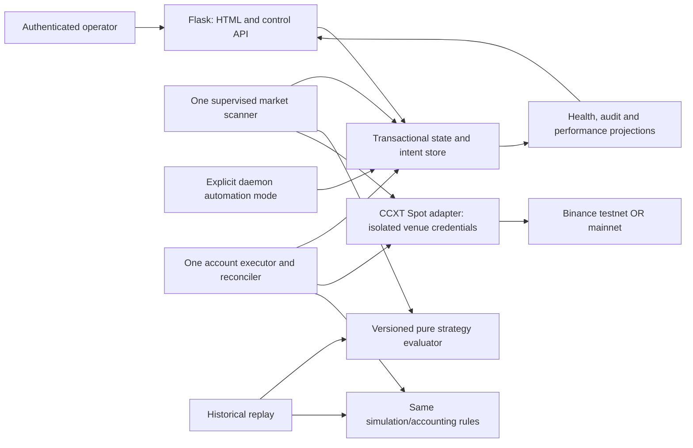

# Binance Top-Down remediation implementation specification

Version: 0.3, 2026-10-02 (Africa/Lagos).
Status: **test boundaries and 16-ticket breakdown approved; published to GitHub; material decisions pending; implementation not authorized**.
Published specification: [2](https://github.com/adeoyewole028/binance_topdown_full/issues/2).

Source revision: `a71999a136b2532e4c84ce53564a98efcf9a77fb`.

## Problem Statement

An operator cannot safely use the current dashboard and daemon to manage a Spot trading account. Anyone reaching the control plane can request trades and change paper mode. Provider effects, local positions, and exits diverge; process restarts and concurrent workers can corrupt or lose state. The backtest cannot validate either runtime strategy or performance. The operator also cannot reliably tell simulation from real trading, stale scans from healthy scans, or accepted orders from confirmed fills.

This specification translates the [end-to-end audit](../../audits/end-to-end-audit-2026-10-02.md) and [provider research](../../audits/provider-research-2026-10-02.md) into a complete remediation proposal. The user's standard-workflow request authorizes these planning drafts. It does not select previously unresolved product/architecture alternatives or authorize code, deployment, credentials, or real trading changes.

## Solution

Keep the existing Python, Flask, CCXT, Spot, dashboard, daemon, and historical-research workflows. Secure the operator boundary, give each account/venue/mode one durable execution owner, route every manual and automated action through validated order intents and reconciliation, and provide a trustworthy simulation and historical replay using explicitly versioned strategies. Make protection, failure, recovery, and rollout independently observable and verifiable.

All A01-A19 findings and PR01-PR07 provider findings remain in scope. No approved constraint is weakened to bypass a difficult gate. Proposed consequential decisions appear in the decision register and cannot be silently selected by implementation. Closure requires all accepted requirements, sandbox and deployment gates, and any authorized production gates, not merely passing local tests.

## User Stories

1. As an operator, I want authenticated dashboard and account access, so that unauthorized callers cannot inspect or trade my account.
2. As an operator, I want browser mutations protected against cross-site requests, so that another website cannot submit financial actions.
3. As an operator, I want venue and execution mode clearly separated, so that simulation cannot unexpectedly become a mainnet order.
4. As an operator, I want explicit reviewed mode transitions, so that omitted form fields cannot change execution permissions.
5. As an operator, I want persistent isolated paper/testnet/mainnet records, so that a paper position cannot become a real sell.
6. As an operator, I want configuration validated and versioned, so that invalid values and mid-order changes cannot change risk silently.
7. As an operator, I want fresh market data for held symbols even after universe changes, so that my positions remain observable.
8. As an operator, I want a truthful scan heartbeat and degraded state, so that a healthy web page cannot conceal a dead scanner.
9. As an operator, I want rejected paper orders to leave cash and holdings unchanged, so that simulation results remain credible.
10. As an operator, I want sizing to respect available capital, exchange rules, exposure and cooldown, so that a UI estimate cannot bypass server controls.
11. As an operator, I want retries to return the same durable order operation, so that duplicate submission does not multiply exposure.
12. As an operator, I want ambiguous exchange results reconciled, so that timeouts do not masquerade as definitive rejection.
13. As an operator, I want partial fills and fees recorded, so that positions and balances reflect what actually happened.
14. As an operator, I want confirmed exchange-native protection or a conspicuous failure state, so that displayed stop settings do not imply nonexistent protection.
15. As an operator, I want reviewed closes coordinated with protective orders, so that a racing stop and manual sell cannot oversell.
16. As an operator, I want restarts to recover holdings, pending operations, protection and cooldowns, so that execution cannot resume from an empty snapshot.
17. As an operator, I want manual and automated orders to use the same controls, so that the daemon cannot bypass dashboard safety.
18. As a researcher, I want the selected strategy evaluated identically in replay and runtime, so that backtests validate a documented strategy.
19. As a researcher, I want only completed candles available at decision time, so that later prices cannot influence earlier entries.
20. As a researcher, I want paginated historical coverage with warmup and gap reporting, so that an empty or truncated history cannot be presented as a valid backtest.
21. As a researcher, I want entries, exits, capital, fees and slippage simulated, so that trade counts are not presented as profitability evidence.
22. As an operator, I want metrics derived from durable history and actual equity, so that refresh, truncation and restart cannot rewrite performance.
23. As an operator, I want form values preserved during updates and recoverable errors, so that refreshing status does not discard my work.
24. As an operator, I want keyboard-accessible actions, readable status and announced errors, so that important actions work without relying on color or sound.
25. As a maintainer, I want imports and offline CI to have no exchange side effects, so that checking source cannot start trading or scanning.
26. As a maintainer, I want reproducible dependencies and one CI-gated release owner, so that deployments do not race or skip verification.
27. As an operator, I want backed-up state and tested restore procedures, so that storage failures do not lead to silent financial resets.
28. As an operator, I want a kill switch that blocks new entries while preserving recovery and protection, so that stopping risk does not abandon existing exposure.
29. As a maintainer, I want redacted audit and operational evidence, so that support and research do not leak credentials or sensitive provider payloads.
30. As an operator, I want sandbox and controlled rollout evidence recorded separately, so that local success is not mistaken for production acceptance.

## Existing System and Regression Boundaries

The dashboard currently scans 4h trend/1h bias/15m execution with candlestick or EMA/RSI-cross entry. It supports manual simulation and live order calls. The daemon currently uses 1d trend/4h bias/15m candlesticks and attempts autonomous buys. Shared EMA, simple rolling-mean RSI, close-based HH/HL pivots, engulfing and hammer definitions must be characterized before refactoring. No silent switch to Wilder RSI or OHLC pivots is permitted. The backtester is currently an entry counter with causal and coverage defects; incorrect results are not a compatibility requirement.

Preserve dynamic volume-ranked universe and static fallback, quote selection, daemon whitelist/blacklist, existing valid strategy parameters, symbol and side selection, risk/fixed-allocation workflows, observable positions, exit reasons, optional sound, and useful CSV export. Explicitly retire false balances, simulated cooldown labels, unused trailing protection claims and success flashes for rejected operations. Preserve existing legitimate paper positions through a reviewed migration, but do not infer complete history or account ownership from legacy snapshots.

Current HTTP entry points `/`, `/api/status`, `/trade`, `/close`, `/update-config`, `/reset-config` remain compatibility adapters where safe. Auth and validation intentionally tighten their behavior. No raw legacy endpoint can bypass the shared order service. A route compatibility check is distinct from preservation of insecure access.

## Decision Register and Approval State

| Decision | Proposed direction | Alternative / trade-off | Blocks |
|---|---|---|---|
| D01 Operator authentication | Single configured operator with password hash, login throttling, secure session and CSRF; no registration or password reset product | Upstream identity provider may be preferable if already deployed; requires external configuration and current docs | BT02, BT12, BT13 |
| D02 Topology and authoritative storage | One paid single-host service, multiple HTTP processes and one supervised scanner/executor, transactional SQLite with write serialization and verified backups | Separate Render services require shared Postgres; mounted disks are not a cross-service datastore. Select one; never deploy SQLite onto independent services | BT03 onward, BT14 |
| D03 Product modes and activation | Preserve advisory dashboard/manual trading and separate automation entry point; both route through one executor, automation disabled by default | Remove automation if product is intended to be advisory only. This changes scope and must update tickets | BT09, BT15, BT16 |
| D04 Strategy contract | Preserve two explicitly named/versioned existing profiles (daemon daily and dashboard intraday), both replayable; no automatic selection | Choose one authoritative profile and explicitly deprecate the other | BT08, BT09, BT10 |
| D05 Capital and protection | Separate initial paper cash from equity display; fixed/risk allocation, cap to available funds/exposure; supported Spot OCO after fills; halt new entries on unprotected exposure | Risk limits, fees, slippage, drawdown kill rules and stop-market versus stop-limit behavior require selected values; automatic emergency liquidation is not assumed | BT05, BT06, BT07, BT10, BT11 |
| D06 Legacy identity / ownership | Legacy snapshots imported as quarantined paper records after operator confirms origin; exchange records authoritative for testnet/mainnet | Unknown-origin positions remain read-only review records. Never infer real holdings from file name or old paper setting | BT03 migration, BT15 |
| D07 Operations | Named operator, configured freshness/scan/reconciliation intervals, alert destination, backup retention, RPO/RTO and canary budget | Numerical values, hosting spend and monitoring duration are unapproved; missing settings block activation | BT04 operational targets, BT14-BT16 |
| D08 Tracker and review | Resolved: repository GitHub Issues; specification and all 16 tickets published and verified with ready-for-agent triage and native dependencies | Local artifacts mirror the published issues; remaining decision blockers are explicit | None for publication |

The user approved both test boundaries and the 16-ticket granularity/dependency breakdown on 2026-10-02. This satisfies the skills' seam and breakdown review gates. The approval covered test boundaries and breakdown; the subsequent go-on instruction was applied to repository GitHub publication. Missing policy values and implementation/deployment/trading authorization remain unresolved. D01-D07 remain recorded material decisions; D08 is resolved to GitHub Issues and publication is verified. Do not treat a triage label as evidence that these blockers are resolved.

## Implementation Decisions

### S1 Scope and invariants — R01-R03

R01: unauthorized and cross-site requests never create orders, change mode/config, reset state or reveal account-specific telemetry. Authentication sessions do not themselves authorize a venue change. Require production secret; reject missing/default secrets in production; debug/reload only on explicitly isolated development.

R02: execution mode is `paper` or `exchange`; venue is `testnet` or `mainnet`. Simulation market-data venue is explicit and does not require private credentials. A server-controlled live allow gate is independent of mutable config; mainnet activation needs separately recorded authorization. Partial updates preserve omitted booleans. Venue/account identity cannot change while unresolved operations or exposure remain. All worker/import startup is side-effect free; explicit launcher owns background lifecycle. Environment parsing is identical for daemon and dashboard, supports documented compatibility aliases only with conflict rejection, and validates before private calls.

R03: manual, daemon and close actions use the same operation service. Account/venue/mode/strategy identifiers qualify every intent, fill, position, metric and risk reservation. Kill switch stops new entries but permits authenticated risk reduction, provider status reads and confirmed protection maintenance; it does not blindly cancel protective orders. Every durable write failure blocks execution rather than displaying a filled/saved result.

### S2 Target architecture — R04

R04: HTTP workers never dispatch Binance orders directly or start scanners on import. One execution owner per configured account/venue serializes intent dispatch, risk reservations and protection/close coordination. The daemon attaches to this owner or acts as the explicitly sole supervised launcher; simultaneous legacy launch cannot create another owner. Acquire ownership before private submission. Do not rely on process-local globals for ownership. Lock expiry alone is insufficient fencing: resolve prior in-flight provider outcomes before takeover. If database/ownership becomes uncertain, halt new dispatch; keep stable operation IDs and reconcile after recovery. Single-host database/OS locking is the D02 proposal; if multi-host is selected, define fencing and shared-database ownership before proceeding.

### S3 Data model, persistence and migration — R05

All times UTC with explicit candle open/close/as-of meanings; display timezone is labelled. Money and crypto quantities use decimal arithmetic and exchange-compatible decimal strings at boundaries, with explicit asset/currency; no universal cents assumption.

| Entity | Essential fields and invariants |
|---|---|
| Account namespace | Opaque local account ID, venue, execution mode, base quote; credentials only in secret configuration, never database or logs |
| Config version | Monotonic version, validated complete values, strategy profile/version, effective time, actor; immutable once referenced |
| Order intent | Operation ID, namespace, idempotency key, canonical request hash, symbol, side, requested qty/notional, config/signal reference, status, provider client/order IDs, timestamps and error class |
| Provider observation | Order reference, observed status/filled qty/cost and provider timestamp; append-only deduplicated observation identity |
| Fill | Unique namespace/provider fill ID, order reference, qty, price, quote cost, fee amount/asset and timestamp; unknown fee conversion is explicitly unresolved |
| Protection group | Position/lot reference, intent/list/leg IDs, protected qty, threshold prices, state, latest verification; separate from entry order status |
| Paper balance / reservation | Asset, available and reserved values, initial capital event, intent; no negative spendable balance; immutable movements reconcile to projections |
| Position projection | Namespace/symbol, confirmed qty/cost basis, realized/unrealized values; derived from durable fills and approved cost-basis policy, not requested order amount |
| Signal / scan | Profile/config version, venue/symbol/candle key, as-of time, inputs provenance, reason, freshness, scan completion and error class |
| Cooldown / risk projection | Namespace/symbol, durable last qualifying event time, current open/reserved exposure; released from confirmed lifecycle changes |
| Audit / runtime health | Actor/operation/config identity, redacted event, timestamps; heartbeat, last success, degraded reason, ownership and reconciliation state |
| Migration / research run | Schema/source checksums, import provenance/quarantine status; replay range, coverage, strategy/config/fee/slippage versions and result provenance |

Unique constraints: namespace + idempotency key, namespace + provider order/fill ID, profile + config + venue + symbol + execution candle key. Index pending intents by namespace/status/time, observations/fills by provider identity, scans by symbol/profile/as-of. Store current projections transactionally with journal effects; transitions are append-only/auditable and compensations do not edit financial history. Provider order IDs alone do not define business idempotency. Keep business operation IDs for the life of retained financial history; do not assume provider client IDs are globally unique forever.

R05: back up legacy snapshots and CSV before migration; inspect types, finite positive qty/entry, duplicates and unknown provenance; quarantine anomalies. Do not invent missing fees, fills or initial capital. Migrating the same checksum twice has no additional effect. Compare pre/post record counts and confirmed paper quantities, document all quarantines. Legacy files remain read-only migration input, never a dual-write source of truth. Required sequence: pause new writes -> backup/checksum -> transactional schema migration/import -> integrity checks -> ownership acquisition -> provider reconciliation where applicable -> resume only approved mode. Rollback retains new journal data and uses a compatible reader; older JSON-writing binaries may not resume against migrated state. Corruption or disk loss must not become an empty tradable account.

### S4 Market data, configuration and supervision — R06-R07

R06: every price/candle has venue, symbol, fetched-at and completed-bar metadata. Validate sorted unique timestamps and OHLC consistency; require enough warmup and reject gaps for affected decisions. Never trade on the currently forming candle. Market-data failures have distinct transient, auth, rate-limit, invalid-market and data-quality classes. Use bounded backoff/jitter and provider-directed wait; share an IP/venue budget across scanner, execution, reconciliation and historical fetches. Prioritize risk reduction/reconciliation over new entries/research. A failed request does not reset freshness. Clock skew is measured; failed clock/freshness checks block order dispatch.

Maintain universe symbols plus all held/pending/protected symbols. Cache only completed candles keyed by venue/symbol/timeframe/candle timestamp; invalidate on new close and verify gap/freshness. Cache loss triggers refetch/degraded status, not filled orders. Ticker cache is an estimate, never fill authority. Reuse slow timeframe history; preserve documented whitelist/blacklist and quote rules; inactive/non-Spot markets cannot enter the tradable set.

R07: config updates validate finite values, numeric domains and cross-field constraints atomically. Proposed domains: risk >0 and <=1, stop distance >0 and <1, RSI thresholds in [0,100], positive integral capacities/intervals, nonnegative cooldown and volume, canonical quote/profile/mode enums and supported markets. More restrictive capital/loss bounds require D05. Every scan and intent snapshots one complete config version. Changing strategy/quote does not rewrite open position exit rules without a separately reviewed policy change. Legacy trailing_pct is explicitly unsupported/disabled unless D05 selects and specifies verified trailing behavior; never imply it is active. Successful scan time advances only after completed work; failure or death sets degraded/stale status. Ownership, heartbeat and current reason are separate from web liveness.

### S5 Orders, simulation and risk — R08-R10

R08: reject missing, zero, negative, NaN/infinite quantities, invalid side/symbol, stale prices, inactive markets, oversells, overspend, unresolved ownership/state, insufficient warmup and invalid limits before mutation. Reject rather than silently reinterpret non-buy as sell or fill at zero. Derive server sizing from available funds plus approved equity/risk/stop policy; fixed allocation is currency-qualified rather than universally USD. Reserve available funds/holdings and open-position slots transactionally before dispatch. Max positions and cooldown apply across manual and daemon entry paths; reduction is not blocked by an entry cooldown. Server recomputes UI estimates and binds reviewed config/price version; changed inputs require refreshed review.

R09: paper execution is isolated, deterministic for fixtures, accounts for fees and approved slippage, records partial/full fills per selected model, and updates cash/holdings/history/projections atomically. Paper protection and exits use the same lifecycle contract with explicit simulation semantics. Invalid/rejected orders do not change balances or holdings; no fabricated quote balance fallback. Initial paper capital comes from approved explicit seed events. equity_proxy remains a labelled estimate only and cannot authorize spending; its value saves correctly if retained.

R10: persist immutable semantic order intent and stable client-order ID before network dispatch. Same idempotency key + same canonical request returns original operation; same key + different request returns conflict without dispatch. A new key does not bypass current exposure/close coordination. Use CCXT precision formatting and current Spot filters (amount/market amount/tick/notional and applicable limits); metadata failures block execution. Submitted quantity is not filled quantity. Timeout after dispatch yields unknown; query status/fills by persisted references before considering any resubmission. Never treat not-yet-found immediately after timeout as proof the order did not exist. Store partial fills, costs and fees independently; reserve/release only confirmed remainder. Reconciliation reads balances/open orders/trade history with overlap and deduplication, tolerates delayed/out-of-order observations and never regresses terminal filled facts. Testnet resets are explicit review/reconciliation events, not permission to mix mainnet state.

Order lifecycle: created -> validated/reserved -> submitting -> accepted/partially_filled/filled/rejected; accepted or partial can end canceled/expired with fills retained. Submitting can become unknown -> reconciliation_required -> observed provider state. A pre-dispatch failure can release reservation; ambiguous dispatch cannot. Audit every transition, actor and canonical reference. Do not log full responses or secrets.

### S6 Protection and risk reduction — R11

R11: use a provider-supported Spot contingent/OCO design selected under D05, with symbol precision and actual sellable filled quantity after fees. Protection has installing/unknown/active/failed/canceling/closed states; active only after provider verification. Failed protection preserves filled entry and surfaces unprotected exposure; blocks new entries and alerts operator. No automatic emergency liquidation is invented. A manual close first resolves/cancels applicable protection, reconciles races/fills and computes remaining sellable qty. Duplicate/racing close requests cannot oversell; cancellation timeout is unresolved, not a permission to issue another sell. Partial close leaves confirmed remainder tracked and reprotected under selected policy. A stopped worker must not imply exchange-native protection disappeared; verify it on recovery. No local polling claim substitutes for a confirmed exchange stop. Live provider stop behavior cannot guarantee execution price.

### S7 Shared strategies and automation — R12-R13

R12: version and document each D04-selected profile, exact timeframes, EMA spans/warmup, rolling RSI and close-pivot semantics, entry/exit ordering, thresholds and reasons. One deterministic evaluator takes only completed bars as of a decision time, immutable config and observed position state; it returns signal identity/reasons with no network/database side effects. Golden fixtures preserve valid legacy indicator/profile outputs, with causal timing defects explicitly corrected and documented. Duplicate scans on the same execution candle cannot create another automatic intent for the same strategy/config/namespace/symbol.

R13: daemon and dashboard share evaluator, market freshness, sizing, intent dispatch, protection and reconciliation. Automation has an explicit start/stop status and cannot run before reconciliation and approved controls. Confirmed exits decrement exposure/open slots and preserve cooldown history through restart. Graceful shutdown stops intake, persists status and preserves unknown intents for recovery. A second daemon launch fails ownership acquisition. No autonomous live enablement from defaults, imports, reset or form omissions.

### S8 Historical replay and performance — R14-R15

R14: fetch explicit UTC start/end ranges by pagination, include required pre-start warmup, validate coverage and gaps, and bound every dataset by as-of close. Replay forward at execution-candle boundaries; no same-day final close before daily close, no future bias authorizing earlier entry, no overlapping duplicate entries. Runtime and replay use the same profile evaluator and approved simulation/capital/protection rules. Report partial data as incomplete rather than valid zero trades. Fees/slippage/seed/cost-basis policies are recorded and reproducible. Define conservative same-bar stop/TP ambiguity, gap prices and partial-fill assumptions under D05; OHLC alone cannot prove intrabar order. CLI date/profile input and result provenance replace hard-coded historical range. Results include fills, positions, exposure, equity, realized/unrealized return, drawdown and win-rate denominator. No promise of profit or inference of live fidelity from candles.

R15: metrics read full durable history, not the latest displayed trades. Initial capital and asset/currency-qualified holdings plus cash define equity; peak-to-trough account equity defines drawdown. Disclose price/fee conversion freshness, unknown cost basis and incomplete imported history; unresolved data yields unavailable/partial metrics rather than false zero. Chosen cost-basis method and win-rate denominator are explicit and shared with replay. Reload/restart/pagination cannot change totals; snapshots may accelerate projections but are rebuildable from the journal.

### S9 Operator journeys and API contracts — R16-R17

Existing GET status/dashboard require authentication. HTML unauthenticated requests redirect to login; JSON requests return 401; unauthorized actions return 403, validation 422, stale/review or idempotency conflicts 409, unavailable dependencies 503. These are proposed stable error contracts, with field-level message and safe operation ID, never provider stacks. Browser adapters redirect after submission but preserve input and display operation status rather than asserting fill from a successful response.

Order request contract includes symbol, canonical side, decimal qty or approved server sizing instruction, namespace, review/config version and idempotency token. Close references a durable position/operation and expected remaining qty/version. Server verifies ownership and recomputes availability. Add authenticated durable operation lookup with status, observed fills, protection and recovery next action. Mode transitions are distinct reviewed requests, not ordinary checkbox casts. Config updates include expected version, reject conflicts, preserve omitted values and never change immutable environment gate. Reset retains mode/venue safety gates and cannot delete financial records. Status response includes namespace/mode/venue, heartbeat and last successful scan, data age, config/profile version, positions, balances, orders, protection, metrics availability and degraded reasons; account CORS is same-origin unless an explicit authenticated client policy is approved.

R16: preserve entered quantities, choices and settings while polling status; loading/empty/stale/offline/failed/unknown/permission/success states are distinct. Visible mode/venue and confirmed versus estimated values precede submit. Require reviewed action for live trade/close/mode change, prevent duplicate clicks while permitting safe recovery by same operation ID. Keep open positions closable independently of exit-signal occurrence. Signal IDs use candle identity rather than scan timestamp; optional sound is opt-in and never sole alert. Settings use canonical enum controls and clear operator language.

R17: retain layout and extract reusable status/form components only as needed. Target WCAG 2.2 AA: labelled controls, keyboard/focus, non-color states, live announcements, semantic tables, adequate targets, contrast, zoom/reflow and reduced motion. Self-host production styles instead of runtime third-party build CDN. Validate real narrow/wide viewports and error paths; source inspection alone cannot satisfy accessibility acceptance.

### S10 Operations, testing, rollout and closure — R18-R20

R18: pin and document tested Python/library versions with repeatable installation; offline lint/type/syntax/behavior/build checks never start exchange requests. Hosted CI performs applicable full suite after focused checks. Deployment has one gated release owner; disable competing autoDeploy/hooks as appropriate with authorized configuration. Supported paid topology, persistent path/database, supervision and readiness distinguish web liveness from reconciled execution readiness. Secrets are required externally and excluded from reports/logs; trading-only least privilege, no withdrawal permission, key rotation procedures and network restrictions are verified at provider gates.

R19: structured redacted logs/metrics correlate operation/config/signal/provider references; alert on scanner death/staleness, unresolved outcomes, unprotected exposure, rejected persistence, owner loss, repeated rate limiting and reconciliation differences. Bounded research jobs cannot exhaust execution request budget. State retention/backup policy under D07 preserves financial provenance and sensitive-data access; no destructive history cleanup on default resets. Test point-in-time backup/restore appropriate to selected store, disk-full/corruption/restart/concurrent-worker scenarios, and approved RPO/RTO. All critical incidents have stop-new-entry, reconcile, protection and recovery runbooks. Do not send external alerts or configure provider accounts during planning.

R20: rollout stages are offline -> deployed isolated paper -> Spot testnet -> separately authorized mainnet canary -> monitored acceptance -> closure. Sandbox validation uses order/fill/protection queries; a provider test-order endpoint alone does not prove a real sandbox fill/protection lifecycle. Record revision, environment, dependency versions, metadata, redacted operation evidence, before/after holdings, negative paths and monitoring interval. Require explicit mainnet amount/symbol/time budget and operator approval; none is provided now. Canary stops on unexpected dispatch, unprotected exposure, mismatch, stale state, duplicate effect or persistence/ownership failure. Rollback disables new writes while preserving protection and reconciliation; it cannot reverse fills. Overall initiative stays open until accepted rollout gates and operational handoff are satisfied; if mainnet is excluded by later approved scope, document that exclusion rather than falsely claiming production proof.

## Testing Decisions

Proposed seam S-A: operator HTTP journey through the Flask test client to a transactional disposable store and fake CCXT boundary. Exercise auth, CSRF, mode/config, review, order intent, worker processing, provider observations, restart and status. Assertions concern requests/observed holdings/order effects, not helper-call counts or exact class layouts. This extends the audit's existing HTTP seam without its AST startup workaround; import/startup must become genuinely safe.

Proposed seam S-B: pure profile evaluator and forward replay with timestamped fixture candles, controlled clock and deterministic fills. Assert future-data perturbations cannot change prior decisions, strategy parity at the same as-of time, complete coverage and accounting invariants. Provider sandbox, multi-process restore and browser journeys are mandatory acceptance layers above these seams; mocked tests never substitute for them.

Prior art: audit offline reproductions are defect evidence only. No project behavioral suite exists. Baseline test ticket records valid indicator/profile fixtures and unsafe observed behavior as tests to correct, not expected compatibility. Required test classes: anonymous/forged/cross-site writes; omitted booleans; invalid/NaN values; zero-price/stale inputs; simultaneous reservation/duplicate submissions; timeout after remote success; late partial fills; protection failure/cancel-fill race; two owners/restart/disk loss; migration repeat/corrupt input; testnet reset; historical pagination/gaps/warmup/future perturbation; metrics beyond display history; form preservation/focus/announcements; deployment/readiness/backup restore. Relevant lint/type/build checks and full applicable suite close every implementation ticket, with code-review, scoped commit and durable evidence. A known external blocker keeps the ticket open and stops dependent work.

## Out of Scope

No feature implementation in this planning task. No autonomous production rollout, real trades, credential changes, issue publication to an unconfigured destination, or tracker invention. No derivatives, short-selling, leverage, withdrawal/payout handling, customer custody, multi-tenant wallets, financial advice, new strategy optimization, exchange expansion, microservices/sharding/multi-region, or unsolicited visual redesign. Trailing automation is excluded until D05 explicitly selects a contract; removal/disabled labelling remains required. A profitable strategy is not an acceptance criterion.

## Further Notes

The approved 16 slices and all blocker/acceptance details are in [the execution ledger](execution-ledger.md). [Traceability](traceability.md) covers every audit/provider finding and requirement. All 16 tickets are published to the configured repository GitHub tracker and mirrored locally. Seam/breakdown approval is recorded; D08 is resolved. The published specification remains open and its body was not altered because ticket publication completed.

Primary documentation was checked during this planning turn for [Spot trading/order-list contracts](https://developers.binance.com/en/docs/catalog/core-trading-spot-trading/api/rest-api/trade) and [Render disk topology](https://render.com/docs/disks). Other provider/version details reference the preserved research; reverify exact pinned adapter, filters, venue and testnet behavior during implementation/sandbox acceptance. The CCXT manual fetch exceeded the browsing tool's content limit this turn; this is not a new successful verification of that page. Do not infer unverified installed/provider behavior from current upstream source alone.
